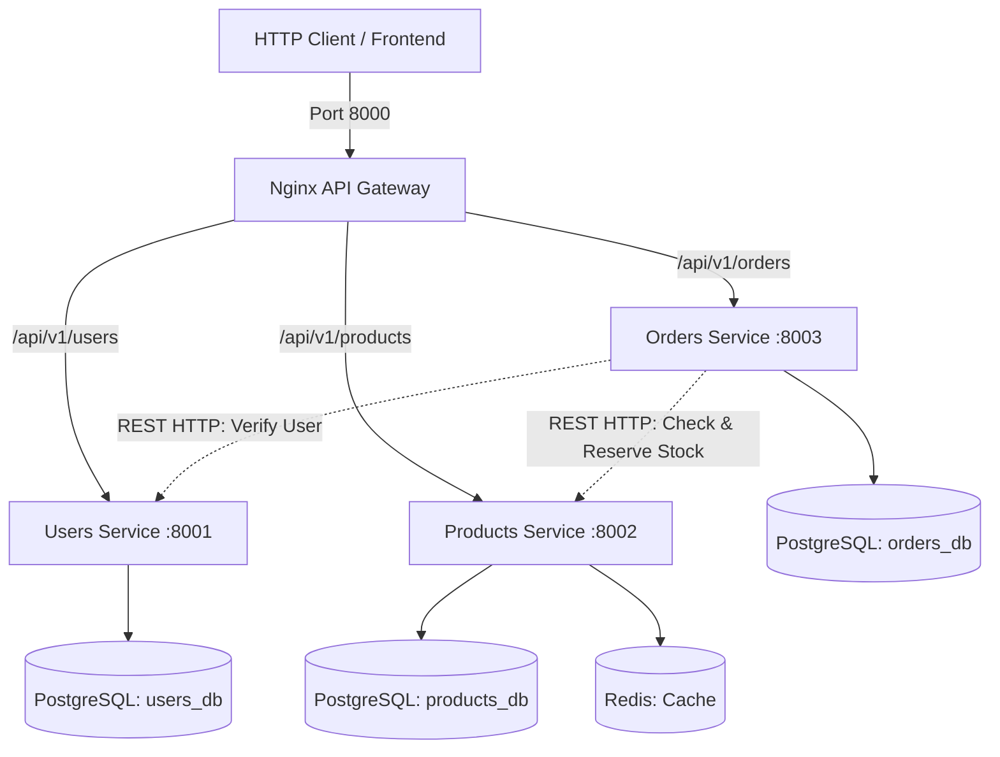

# DevOps Platform — Microservices Architecture

Цей проєкт розроблений для лабораторних робіт та практичних завдань з курсу **DevOps**.
Він реалізований за принципом **Microservices Architecture (Database per Service)** з автономними сервісами, власними базами даних, ізольованими Dockerfile та єдиною точкою входу через **Nginx API Gateway**.

---

## 🛠 Технологічний стек

- **Мова програмування:** Python 3.12+
- **Менеджер пакетів та віртуального середовища:** [uv](https://github.com/astral-sh/uv)
- **Веб-фреймворк:** [FastAPI](https://fastapi.tiangolo.com/) + Pydantic v2
- **ORM / База даних:** [SQLAlchemy 2.0](https://www.sqlalchemy.org/) (Asyncio) + PostgreSQL 16 (`asyncpg`)
- **Міграції:** [Alembic](https://alembic.sqlalchemy.org/) (Async) окремо для кожного сервісу
- **Міжсервісна взаємодія:** REST HTTP клієнти (`httpx`)
- **API Gateway:** Nginx Reverse Proxy (порт 8000)
- **Кеш / Брокер:** Redis 7
- **Логування:** [Loguru](https://github.com/Delgan/loguru) зі структурованим перехопленням логів
- **Лінтери та типізація:** Ruff, Mypy
- **Тестування:** Pytest (Unit, Integration, API/E2E з підтримкою асинхронності та mock-клієнтів)
- **Контейнеризація:** Multi-stage Dockerfile на базі `uv` + Docker Compose

---

## 🏛 Архітектура сервісів

| Сервіс | Порт | База даних | Опис відповідальності |
| :--- | :--- | :--- | :--- |
| **API Gateway** | `8000` | — | Nginx reverse proxy, маршрутизація запитів на сервіси |
| **Users Service** | `8001` | `users_db` | Управління користувачами, статусами активності, профілями |
| **Products Service** | `8002` | `products_db` | Каталог товарів, ціни, резервування та списання залишків на складі |
| **Orders Service** | `8003` | `orders_db` | Управління замовленнями, координація з Users та Products через REST |



---

## 📂 Структура проєкту

```text
.
├── gateway/
│   └── nginx.conf                # Конфігурація Nginx API Gateway (порт 8000)
├── services/
│   ├── users/                    # Мікросервіс користувачів (порт 8001)
│   │   ├── pyproject.toml
│   │   ├── Dockerfile
│   │   ├── alembic.ini & alembic/
│   │   ├── src/ (main, router, service, repository, models, schemas, seed)
│   │   └── tests/ (unit, integration, api)
│   ├── products/                 # Мікросервіс товарів (порт 8002)
│   │   ├── pyproject.toml
│   │   ├── Dockerfile
│   │   ├── alembic.ini & alembic/
│   │   ├── src/ (main, router, service, repository, models, schemas, seed)
│   │   └── tests/ (unit, integration, api)
│   └── orders/                   # Мікросервіс замовлень (порт 8003)
│       ├── pyproject.toml
│       ├── Dockerfile
│       ├── alembic.ini & alembic/
│       ├── src/ (main, router, service, repository, models, schemas, clients)
│       └── tests/ (unit, integration, api)
├── scripts/
│   ├── init-multiple-dbs.sh      # Ініціалізація баз даних users_db, products_db, orders_db
│   └── pg_backup_rotated.sh      # Ротаційний бекап усіх мікросервісних БД
├── docker-compose.yml            # Оркестрація всіх сервісів
├── .env.example                  # Шаблон змінних середовища
├── .env                          # Локальний файл змінних середовища
├── .gitignore
└── README.md
```

---

## 🚀 Швидкий старт (Локальна розробка через uv)

### 1. Перевірка та тести для кожного сервісу

```bash
# Users Service
cd services/users
uv run pytest -v
uv run ruff check .
uv run mypy .

# Products Service
cd ../products
uv run pytest -v
uv run ruff check .
uv run mypy .

# Orders Service
cd ../orders
uv run pytest -v
uv run ruff check .
uv run mypy .
```

---

## 🐳 Запуск через Docker Compose

```bash
# Запуск усієї інфраструктури (Postgres, Redis, 3 сервіси, Nginx Gateway, Backup)
docker compose up -d --build

# Перевірка статусу контейнерів
docker compose ps

# Перегляд логів
docker compose logs -f gateway
docker compose logs -f orders

# Зупинка
docker compose down
```

### Ендпоінти через API Gateway (порт 8000):
- **Gateway Health:** `http://localhost:8000/health`
- **Users API:** `http://localhost:8000/api/v1/users`
- **Products API:** `http://localhost:8000/api/v1/products`
- **Orders API:** `http://localhost:8000/api/v1/orders`

Прямий доступ до сервісів:
- Users Service: `http://localhost:8001/docs`
- Products Service: `http://localhost:8002/docs`
- Orders Service: `http://localhost:8003/docs`

---

## ☸️ Розгортання в Kubernetes (Lab 3)

Проєкт адаптовано для декларативного розгортання в Kubernetes-кластері (наприклад, [Minikube](https://minikube.sigs.k8s.io/)) з використанням маніфестів у каталозі `k8s/`.

### 1. Передумови (Prerequisites)
- **Docker** 24+
- **Minikube** v1.30+
- **kubectl** v1.28+

Запуск кластера Minikube та активація необхідних доповнень (Ingress, Metrics Server):
```bash
# Запуск кластера з драйвером docker
minikube start --driver=docker

# Активація доповнень
minikube addons enable ingress
minikube addons enable metrics-server
```

### 2. Розгортання однією командою (Single-command deployment)

Усі маніфести організовані в каталозі `k8s/`. Для розгортання всієї інфраструктури (Namespace, Stateful-сховища, Microservices, API Gateway, Ingress) виконайте:

```bash
# Створення ізольованого namespace та рекурсивне застосування всіх маніфестів:
kubectl apply -f k8s/00-namespace.yaml && kubectl apply -R -f k8s/
```

Перевірка статусу розгорнутих компонентів:
```bash
kubectl get all,pvc,ingress -n devops-lab3
```

### 3. Таблиця параметрів конфігурації (ConfigMap та Secret)

| Сервіс / Ресурс | Тип об'єкта | Назва в K8s | Параметр (Ключ) | Опис та призначення |
| :--- | :--- | :--- | :--- | :--- |
| **Users Service** | `ConfigMap` | `users-config` | `APP_CONFIG__ENVIRONMENT` | Середовище виконання (`k8s`) |
| | | | `APP_CONFIG__LOG__LEVEL` | Рівень деталізації логів (`INFO`) |
| | | | `APP_CONFIG__DB__HOST` | DNS-хост сервісу PostgreSQL (`postgres`) |
| | | | `APP_CONFIG__DB__PORT` | Порт PostgreSQL (`5432`) |
| | | | `APP_CONFIG__DB__NAME` | Назва бази даних мікросервісу (`users_db`) |
| | | | `APP_CONFIG__DB__USER` | Користувач БД (`devops_user`) |
| | | | `APP_CONFIG__REDIS__HOST` | DNS-хост кешу Redis (`redis`) |
| | | | `APP_CONFIG__REDIS__PORT` | Порт Redis (`6379`) |
| | | | `HTTP_PORT` | Порт запуску застосунку (`8001`) |
| | `Secret` | `users-secret` | `APP_CONFIG__DB__PASSWORD` | Пароль доступу до бази даних |
| | | | `APP_CONFIG__REDIS__PASSWORD` | Пароль доступу до Redis |
| | | | `APP_CONFIG__AUTH__ACCESS_SECRET_KEY` | Секретний ключ для підпису JWT токенів |
| **Products Service** | `ConfigMap` | `products-config` | `APP_CONFIG__ENVIRONMENT` | Середовище виконання (`k8s`) |
| | | | `APP_CONFIG__LOG__LEVEL` | Рівень логів (`INFO`) |
| | | | `APP_CONFIG__DB__HOST` / `PORT` | Адресація бази даних (`postgres:5432`) |
| | | | `APP_CONFIG__DB__NAME` | Назва бази даних (`products_db`) |
| | | | `APP_CONFIG__DB__USER` | Користувач БД (`devops_user`) |
| | | | `APP_CONFIG__REDIS__HOST` / `PORT` | Адресація кешу (`redis:6379`) |
| | | | `HTTP_PORT` | Порт запуску застосунку (`8002`) |
| | `Secret` | `products-secret` | `APP_CONFIG__DB__PASSWORD` | Пароль доступу до бази даних |
| | | | `APP_CONFIG__REDIS__PASSWORD` | Пароль доступу до Redis |
| **Orders Service** | `ConfigMap` | `orders-config` | `APP_CONFIG__ENVIRONMENT` | Середовище виконання (`k8s`) |
| | | | `APP_CONFIG__LOG__LEVEL` | Рівень логів (`INFO`) |
| | | | `APP_CONFIG__DB__HOST` / `PORT` | Адресація бази даних (`postgres:5432`) |
| | | | `APP_CONFIG__DB__NAME` | Назва бази даних (`orders_db`) |
| | | | `APP_CONFIG__DB__USER` | Користувач БД (`devops_user`) |
| | | | `APP_CONFIG__SERVICES__USERS_URL` | Внутрішній URL сервісу користувачів (`http://users:8001`) |
| | | | `APP_CONFIG__SERVICES__PRODUCTS_URL` | Внутрішній URL сервісу товарів (`http://products:8002`) |
| | | | `HTTP_PORT` | Порт запуску застосунку (`8003`) |
| | `Secret` | `orders-secret` | `APP_CONFIG__DB__PASSWORD` | Пароль доступу до бази даних |
| **PostgreSQL** | `ConfigMap` | `postgres-initdb` | `init-multiple-dbs.sh` | Shell-скрипт ініціалізації автономних БД (`users_db`, `products_db`, `orders_db`) |
| | `Secret` | `postgres-secret` | `POSTGRES_USER` | Адміністратор PostgreSQL (`devops_user`) |
| | | | `POSTGRES_PASSWORD` | Пароль доступу до PostgreSQL |
| | | | `POSTGRES_DB` | Базова системна БД (`devops_db`) |
| | | | `POSTGRES_MULTIPLE_DATABASES` | Список баз даних для ініціалізації |
| | | | `POSTGRES_INITDB_ARGS` | Кодування та локаль (`--encoding=UTF-8 ...`) |
| **API Gateway** | `ConfigMap` | `gateway-config` | `nginx.conf` | Конфігурація Nginx, правила upstream та маршрутизація запитів |

### 4. Інструкція з доступу до застосунку (Access instructions)

Отримати IP-адресу кластера Minikube:
```bash
minikube ip
# За замовчуванням: 192.168.49.2
```

#### Спосіб 1: Через NodePort (Порт 30080)
Доступний безпосередньо з хостової машини за адресою:
- **API Gateway Health:** `http://<minikube-ip>:30080/health`
- **Users Service API:** `http://<minikube-ip>:30080/api/v1/users/health`
- **Products Service API:** `http://<minikube-ip>:30080/api/v1/products/health`
- **Orders Service API:** `http://<minikube-ip>:30080/api/v1/orders/health`

#### Спосіб 2: Через Kubernetes Ingress (`devops.local`)
1. Додайте запис до файлу `/etc/hosts`:
```bash
echo "$(minikube ip) devops.local" | sudo tee -a /etc/hosts
```
2. Виконуйте запити на домен `http://devops.local`:
```bash
curl http://devops.local/health
curl http://devops.local/api/v1/users/health
curl http://devops.local/api/v1/products/health
curl http://devops.local/api/v1/orders/health
```

### 5. Очищення ресурсів (Cleanup)

Для повного видалення всіх створених ресурсів та простору імен виконайте:
```bash
kubectl delete -f k8s/00-namespace.yaml
```
Або покрокове видалення об'єктів:
```bash
kubectl delete -R -f k8s/
```

---

## 📦 Пакування та розгортання через Helm (Лабораторна робота №4)

Цей розділ документує пакування всієї мікросервісної платформи **DevOps Platform** у вигляді єдиного декларативного Helm-чарта (`helm/devops-platform/`). Застосування Helm 3 дозволяє уникнути дублювання «сирих» Kubernetes-маніфестів, параметризувати розгортання під різні середовища (`dev` та `prod`), централізовано управляти секретами та конфігураціями, а також надійно керувати життєвим циклом релізів (атомарні оновлення, відкати, хуки життєвого циклу та декларативні тести).

### 1. Призначення чарта та структура каталогу

Чарт `devops-platform` призначений для єдиного, відтворюваного та версіонованого розгортання повного стеку мікросервісів:
- **База даних:** PostgreSQL 16 зі збереженням стану (`PVC`) та скриптом автоініціалізації (`initdb`).
- **Кеш:** Redis 7 з політикою витіснення `volatile-lru`.
- **Мікросервіси:** `users`, `products`, `orders` (Python 3.12, FastAPI).
- **Мережевий шлюз та маршрутизація:** Nginx API Gateway (NodePort 30080) та Ingress Controller (`devops.local`).
- **Забезпечення надійності:** Автоматичні хуки життєвого циклу (Pre-Upgrade Backup Job) та тести працездатності (`helm test`).

#### Структура файлів чарта `helm/devops-platform/`:
```text
helm/devops-platform/
├── Chart.yaml              # Метадані чарта (apiVersion: v2, version: 0.1.0, appVersion: "1.0.0")
├── .helmignore             # Фільтри виключення службових файлів під час пакування
├── values.yaml             # Базові конфігураційні значення за замовчуванням
├── values-dev.yaml         # Профіль середовища розробки (1 репліка, DEBUG, знижені ресурси)
├── values-prod.yaml        # Профіль продакшн-середовища (HA 3/2/2 репліки, INFO, Ingress, вищі ліміти)
└── templates/
    ├── _helpers.tpl        # Спільні Go-шаблони (fullname, labels, selectorLabels)
    ├── NOTES.txt           # Інтерактивна інструкція доступу, що відображається після встановлення
    ├── ingress.yaml        # Декларація Ingress ресурсу (devops.local)
    ├── gateway/            # API Gateway Nginx (ConfigMap, Deployment, Service NodePort 30080)
    ├── postgres/           # СУБД PostgreSQL (Secret, ConfigMap initdb, PVC, Deployment, Service)
    ├── redis/              # In-memory кеш Redis (Deployment, Service)
    ├── services/
    │   ├── users/          # Users Service (ConfigMap, Secret, Deployment, Service)
    │   ├── products/       # Products Service (ConfigMap, Secret, Deployment, Service)
    │   └── orders/         # Orders Service (ConfigMap, Secret, Deployment, Service)
    ├── hooks/
    │   └── pre-upgrade-backup.yaml # Pre-Upgrade Hook (резервне копіювання/валідація перед оновленням)
    └── tests/
        └── test-health.yaml        # Release Test (перевірка HTTP ендпоінтів /health усіх сервісів)
```

> **Різниця між `version` та `appVersion` у `Chart.yaml`:**
> - `version: 0.1.0` — версія самого Helm-чарта (пакета конфігурацій та шаблонів). Змінюється згідно SemVer при редагуванні шаблонів, додаванні параметрів у `values.yaml` або рефакторингу інфраструктури.
> - `appVersion: "1.0.0"` — версія самого бізнес-застосунку/мікросервісів, що пакуються в цей чарт. Змінюється під час випуску нових релізів кодової бази та оновлення тегів контейнерних образів.

---

### 2. Таблиця ключових параметрів конфігурації `values.yaml`

| Секція / Параметр | Тип | За замовчуванням | Опис та призначення |
| :--- | :--- | :--- | :--- |
| `postgres.replicas` | `int` | `1` | Кількість реплік подів бази даних |
| `postgres.image.repository` / `tag` | `string` | `postgres` / `"16-alpine"` | Образ СУБД PostgreSQL |
| `postgres.persistence.enabled` | `bool` | `true` | Активація PVC для збереження бази даних |
| `postgres.persistence.size` | `string` | `"1Gi"` | Обсяг запитуваного дискового простору |
| `postgres.secret.POSTGRES_DB` | `string` | `"devops_db"` | Системна база даних за замовчуванням |
| `postgres.secret.POSTGRES_MULTIPLE_DATABASES` | `string` | `"users_db,products_db,orders_db"` | Перелік БД мікросервісів для автоініціалізації |
| `redis.image.tag` | `string` | `"7-alpine"` | Версія кешу Redis |
| `redis.maxmemory` / `maxmemoryPolicy` | `string` | `"128mb"` / `"volatile-lru"` | Обмеження пам'яті та стратегія витіснення |
| `users.replicas` | `int` | `2` | Кількість реплік мікросервісу Users |
| `users.image.repository` / `tag` | `string` | `devops-users` / `"1.0.0"` | Контейнерний образ сервісу Users |
| `users.resources.requests` / `limits` | `map` | `cpu: 50m/250m, mem: 128Mi/384Mi` | Обмеження обчислювальних ресурсів |
| `users.config.APP_CONFIG__LOG__LEVEL` | `string` | `"INFO"` | Рівень деталізації логування |
| `products.replicas` | `int` | `1` | Кількість реплік мікросервісу Products |
| `products.image.tag` | `string` | `"1.0.0"` | Тег образу мікросервісу Products |
| `orders.replicas` | `int` | `1` | Кількість реплік мікросервісу Orders |
| `orders.image.tag` | `string` | `"1.0.0"` | Тег образу мікросервісу Orders |
| `gateway.service.type` | `string` | `NodePort` | Тип Kubernetes Service для Nginx Gateway |
| `gateway.service.nodePort` | `int` | `30080` | Зовнішній статичний порт Minikube вузла |
| `ingress.enabled` | `bool` | `true` | Увімкнення Ingress контролера |
| `ingress.host` | `string` | `"devops.local"` | Доменне ім'я доступу до застосунку |

---

### 3. Швидкий старт (Розгортання релізу однією командою)

```bash
# Встановлення релізу у виділений простір імен devops-lab4
helm install devops-release helm/devops-platform -n devops-lab4 --create-namespace

# Моніторинг готовності розгортання подів
kubectl rollout status deployment/postgres -n devops-lab4
kubectl rollout status deployment/gateway -n devops-lab4
kubectl rollout status deployment/users -n devops-lab4

# Перегляд стану створених об'єктів
kubectl get all,pvc,ingress -n devops-lab4
```

---

### 4. Робота з різними середовищами (`values-dev.yaml` vs `values-prod.yaml`)

Чарт підтримує роздільні конфігурації для локальної розробки та промислової експлуатації:

| Параметр | Розробка (`values-dev.yaml`) | Продакшн (`values-prod.yaml`) |
| :--- | :--- | :--- |
| **Репліки (`users / products / orders`)** | `1 / 1 / 1` (економія пам'яті) | `3 / 2 / 2` (High Availability) |
| **Теги образів** | `"dev"` | `"1.0.0"` (фіксований стабільний реліз) |
| **Рівень логів** | `"DEBUG"` | `"INFO"` |
| **Ресурси (`requests` / `limits`)** | `cpu: 25m/100m, mem: 64Mi/128Mi` | `cpu: 100m/500m, mem: 256Mi/512Mi` |
| **Ingress Controller** | `disabled` (`dev.devops.local`) | `enabled` (`devops.local`) |

#### Перевірка різниці маніфестів без розгортання в кластер (`helm template` + `diff`):
```bash
diff -u <(helm template devops-release helm/devops-platform -f helm/devops-platform/values-dev.yaml) \
        <(helm template devops-release helm/devops-platform -f helm/devops-platform/values-prod.yaml)
```

#### Розгортання з конкретним профілем середовища:
```bash
# Розгортання середовища розробки:
helm install devops-dev helm/devops-platform -f helm/devops-platform/values-dev.yaml -n devops-dev --create-namespace

# Розгортання промислового середовища:
helm install devops-prod helm/devops-platform -f helm/devops-platform/values-prod.yaml -n devops-prod --create-namespace
```

---

### 5. Керування життєвим циклом релізу

#### Оновлення релізу через прапорець `--set` (зміна тегу образу):
```bash
helm upgrade devops-release helm/devops-platform -n devops-lab4 --set users.image.tag=1.1.0 --reuse-values
```

#### Оновлення з профілем `values-prod.yaml` (масштабування та спрацювання Pre-Upgrade Hook):
```bash
helm upgrade devops-release helm/devops-platform -f helm/devops-platform/values-prod.yaml -n devops-lab4
```

#### Перегляд історії ревізій та статусів:
```bash
helm history devops-release -n devops-lab4
```

#### Безпечний відкат до базової ревізії 1:
```bash
helm rollback devops-release 1 -n devops-lab4
```

#### Запуск інтегрованих тестів релізу (`helm test`):
```bash
helm test devops-release -n devops-lab4 --logs
```

#### Видалення релізу зі збереженням бази даних (`PVC`):
Завдяки анотації `helm.sh/resource-policy: keep` у шаблоні `templates/postgres/pvc.yaml`, том `postgres-data` залишається збереженим після видалення релізу:
```bash
helm uninstall devops-release -n devops-lab4
# Підтвердження збереження PVC:
kubectl get pvc -n devops-lab4
```

---

### 6. Перевірка доступності застосунку

Отримати IP кластера Minikube:
```bash
export MINIKUBE_IP=$(minikube ip)
```

#### Через NodePort (порт 30080):
```bash
curl -s http://$MINIKUBE_IP:30080/health
curl -s http://$MINIKUBE_IP:30080/api/v1/users/health
curl -s http://$MINIKUBE_IP:30080/api/v1/products/health
curl -s http://$MINIKUBE_IP:30080/api/v1/orders/health
```

#### Через Ingress (`devops.local`):
1. Додайте запис у `/etc/hosts`:
```bash
echo "$MINIKUBE_IP devops.local" | sudo tee -a /etc/hosts
```
2. Виконайте перевірку через домен:
```bash
curl -s http://devops.local/health
curl -s http://devops.local/api/v1/users/health
curl -s http://devops.local/api/v1/products/health
curl -s http://devops.local/api/v1/orders/health
```

