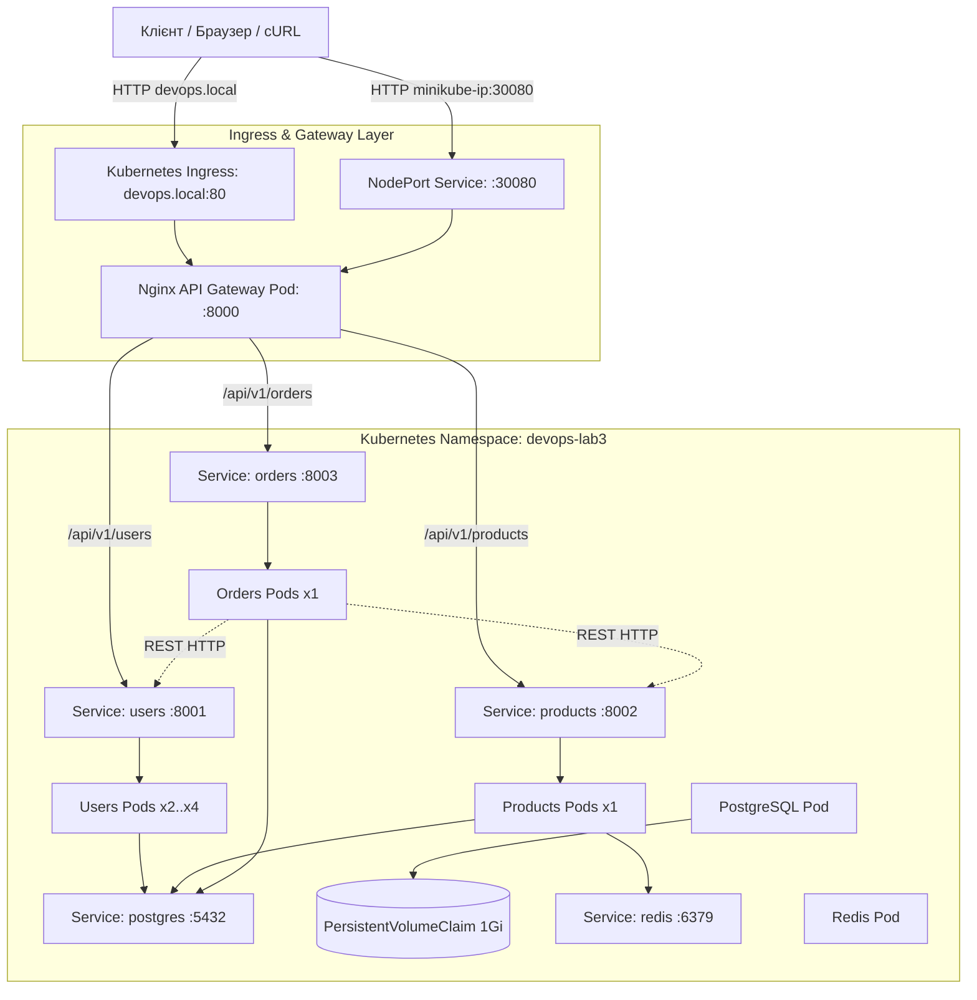

# Звіт з лабораторної роботи №3
## Тема: Розгортання та керування життєвим циклом мікросервісного застосунку в Kubernetes (Minikube)
### Дисципліна: Технології DevOps

---

## Мета роботи
Ознайомитися з архітектурою та основними абстракціями платформи контейнерної оркестрації Kubernetes. Опанувати декларативний підхід до опису інфраструктури застосунку за допомогою YAML-маніфестів (Deployment, Service, ConfigMap, Secret, PersistentVolumeClaim, Ingress). На практиці дослідити механізми керування життєвим циклом у кластері Minikube: самовідновлення (Self-healing), горизонтальне масштабування (Scaling), безшовне оновлення (Rolling Update), відкат ревізій (Rollback) та діагностику типових аварійних ситуацій (Troubleshooting).

---

## Короткий опис архітектури застосунку

Для виконання роботи використано мікросервісну платформу **DevOps Platform**, спроєктовану за патерном **Database per Service**:
1. **Users Service** (`Python 3.12 / FastAPI`) — керування користувачами та профілями, підключений до власної БД `users_db` та кешу Redis.
2. **Products Service** (`Python 3.12 / FastAPI`) — каталог товарів, підключений до БД `products_db` та кешу Redis.
3. **Orders Service** (`Python 3.12 / FastAPI`) — координація замовлень, підключений до БД `orders_db`, взаємодіє з Users та Products через внутрішні REST HTTP виклики.
4. **PostgreSQL 16** — реляційна СУБД із збереженням даних на постійному томі (`PersistentVolumeClaim`).
5. **Redis 7** — in-memory сховище для кешування.
6. **Nginx API Gateway** — єдина вхідна точка зворотного проксі (Reverse Proxy), що перенаправляє клієнтські запити на відповідні мікросервіси.

Всі компоненти розгорнуті в ізольованому просторі імен (`Namespace`) `devops-lab3`.



---

## 1. Підготовка образів застосунку

Відповідно до вимог лабораторної роботи:
- Використано власні образи мікросервісів, побудовані на базі `Dockerfile` з оптимізацією Multi-stage та менеджером пакетів `uv`.
- Заборонено використання тегу `latest`. Усі образи мають фіксовані версії з семантичним версіонуванням.
- Для демонстрації Rolling Update та Rollback підготовлено дві версії мікросервісу `users`:
  - `devops-users:1.0.0` — базовий стабільний реліз (повертає `"version":"1.0.0"` у відповіді `/health`).
  - `devops-users:1.1.0` — оновлена версія застосунку (повертає `"version":"1.1.0"` у відповіді `/health`).
- Образи завантажено безпосередньо у внутрішнє середовище Minikube (`minikube image load`).

Перевірка наявності образів у локальному реєстрі Minikube:
```bash
minikube image ls | grep devops
```

Фактичний результат виконання:
```text
docker.io/library/devops-users:1.1.0
docker.io/library/devops-users:1.0.0
docker.io/library/devops-products:1.0.0
docker.io/library/devops-orders:1.0.0
docker.io/library/devops-gateway:1.0.0
```

> [!TIP] Місце для скріншота 1: Перелік зібраних образів застосунку в кластері Minikube (вивід команди minikube image ls).

---

## 2. Розгортання локального кластера Minikube

Кластер Kubernetes розгорнуто локально за допомогою утиліти `minikube` з драйвером `docker`:

```bash
minikube start --driver=docker
```

### 2.1 Перевірка стану вузла кластера
```bash
kubectl get nodes -o wide
```

Фактичний результат:
```text
NAME       STATUS   ROLES           AGE   VERSION   INTERNAL-IP    EXTERNAL-IP   OS-IMAGE                         KERNEL-VERSION                  CONTAINER-RUNTIME
minikube   Ready    control-plane   43m   v1.37.0   192.168.49.2   <none>        Debian GNU/Linux 12 (bookworm)   7.2.9-200.fc44.x86_64 (amd64)   containerd://2.3.4
```
Вузол `minikube` перебуває у стані **Ready**, використовує середовище контейнеризації `containerd://2.3.4` та версію ядра Linux 7.2.9. Внутрішня IP-адреса вузла — `192.168.49.2`.

### 2.2 Перевірка системних подів у namespace `kube-system`
```bash
kubectl get pods -n kube-system
```

Фактичний результат:
```text
NAME                               READY   STATUS    RESTARTS   AGE
coredns-559f6c778d-r5rj8           1/1     Running   0          43m
etcd-minikube                      1/1     Running   0          43m
kindnet-rkmdm                      1/1     Running   0          43m
kube-apiserver-minikube            1/1     Running   0          43m
kube-controller-manager-minikube   1/1     Running   0          43m
kube-proxy-2frdr                   1/1     Running   0          43m
kube-scheduler-minikube            1/1     Running   0          43m
metrics-server-768f9f6999-bnqdz    1/1     Running   0          43m
storage-provisioner                1/1     Running   0          43m
```
Всі ключові компоненти Control Plane (`etcd`, `kube-apiserver`, `kube-controller-manager`, `kube-scheduler`), мережевий плагін (`kindnet`, `kube-proxy`), внутрішній DNS (`coredns`) та провіжнер сховищ (`storage-provisioner`) працюють у штатному режимі (1/1 Running).

### 2.3 Активація доповнень (Addons)
Для забезпечення моніторингу метрик ресурсів та маршрутизації вхідного HTTP трафіку активовано доповнення `ingress` та `metrics-server`:
```bash
minikube addons enable ingress
minikube addons enable metrics-server
minikube addons list | grep -E "ingress|metrics-server"
```

Фактичний результат:
```text
│ ingress                     │ minikube │ enabled ✅ │ Kubernetes                             │
│ ingress-dns                 │ minikube │ disabled   │ minikube                               │
│ metrics-server              │ minikube │ enabled ✅ │ Kubernetes                             │
```

> [!TIP] Місце для скріншота 2: Стан вузла Minikube та системних подів у namespace kube-system із підтвердженням увімкнених ingress та metrics-server.

---

## 3. Створення та конфігурація namespace `devops-lab3`

Для повної ізоляції застосунку від системних та інших користувацьких процесів створено окремий простір імен `devops-lab3`.

Маніфест `k8s/00-namespace.yaml`:
```yaml
apiVersion: v1
kind: Namespace
metadata:
  name: devops-lab3
  labels:
    name: devops-lab3
    app.kubernetes.io/part-of: devops-platform
```

Застосування маніфесту:
```bash
kubectl apply -f k8s/00-namespace.yaml
kubectl get namespace devops-lab3
```

Фактичний результат:
```text
NAME          STATUS   AGE
devops-lab3   Active   10m
```

> [!TIP] Місце для скріншота 3: Створення та статус простору імен devops-lab3.

---

## 4. Опис написаних маніфестів

Усі маніфести розбито за модульним принципом ("один файл — один об'єкт") у каталозі `k8s/`:

```text
k8s/
├── 00-namespace.yaml                 # Простір імен devops-lab3
├── gateway/
│   ├── configmap.yaml                # Конфігурація Nginx reverse proxy
│   ├── deployment.yaml               # Deployment шлюзу API Gateway
│   └── service.yaml                  # NodePort Service (порт 30080)
├── postgres/
│   ├── configmap-initdb.yaml         # Скрипт ініціалізації БД для мікросервісів
│   ├── secret.yaml                   # Пароль та параметри облікових записів Postgres
│   ├── pvc.yaml                      # PersistentVolumeClaim (1Gi) для збереження даних
│   ├── deployment.yaml               # Deployment БД зі стратегією Recreate
│   └── service.yaml                  # ClusterIP Service для Postgres (:5432)
├── redis/
│   ├── deployment.yaml               # Deployment кешу Redis зі збереженням та лімітами
│   └── service.yaml                  # ClusterIP Service для Redis (:6379)
├── services/
│   ├── users/
│   │   ├── configmap.yaml            # Нечутливі змінні конфігурації Users
│   │   ├── secret.yaml               # Паролі та JWT-ключі Users
│   │   ├── deployment.yaml           # Deployment (2 репліки, probes, resources)
│   │   └── service.yaml              # ClusterIP Service (:8001)
│   ├── products/
│   │   ├── configmap.yaml            # Змінні середовища Products
│   │   ├── secret.yaml               # Паролі доступу Products
│   │   ├── deployment.yaml           # Deployment (1 репліка, probes, resources)
│   │   └── service.yaml              # ClusterIP Service (:8002)
│   └── orders/
│       ├── configmap.yaml            # Змінні середовища Orders (включаючи URL інших сервісів)
│       ├── secret.yaml               # Секрети підключення Orders
│       ├── deployment.yaml           # Deployment (1 репліка, probes, resources)
│       └── service.yaml              # ClusterIP Service (:8003)
└── ingress.yaml                      # Ingress маршрутизація для домену devops.local
```

### 4.1 Таблиця створених об'єктів та їх призначення

| Компонент | Тип об'єкта | Назва в K8s | Призначення та ключові особливості |
| :--- | :--- | :--- | :--- |
| **Namespace** | `Namespace` | `devops-lab3` | Логічна ізоляція всіх ресурсів лабораторної роботи |
| **Users Service** | `Deployment` | `users` | 2 репліки, образ `devops-users:1.0.0`, liveness/readiness проби, обмеження CPU/RAM |
| | `Service` | `users` | Тип `ClusterIP`, внутрішній порт 8001 |
| | `ConfigMap` | `users-config` | Змінні: оточення, рівень логування, хости БД/Redis, порт 8001 |
| | `Secret` | `users-secret` | Паролі доступу до БД та Redis, секретний JWT-ключ |
| **Products Service** | `Deployment` | `products` | 1 репліка, образ `devops-products:1.0.0`, health probes, resource limits |
| | `Service` | `products` | Тип `ClusterIP`, внутрішній порт 8002 |
| | `ConfigMap` | `products-config` | Змінні оточення, конфігурація підключень |
| | `Secret` | `products-secret` | Паролі до БД та Redis |
| **Orders Service** | `Deployment` | `orders` | 1 репліка, образ `devops-orders:1.0.0`, probes, resource limits |
| | `Service` | `orders` | Тип `ClusterIP`, внутрішній порт 8003 |
| | `ConfigMap` | `orders-config` | DNS-адреси залежних сервісів `http://users:8001`, `http://products:8002` |
| | `Secret` | `orders-secret` | Пароль до БД |
| **PostgreSQL** | `Deployment` | `postgres` | 1 репліка, стратегія `Recreate`, підключення PVC та initdb-скрипта |
| | `PersistentVolumeClaim` | `postgres-data` | 1Gi том з режимом доступу `ReadWriteOnce` |
| | `ConfigMap` | `postgres-initdb` | Shell-скрипт автостворення баз `users_db`, `products_db`, `orders_db` |
| | `Secret` | `postgres-secret` | Дані суперкористувача та параметри ініціалізації |
| | `Service` | `postgres` | Тип `ClusterIP`, порт 5432 |
| **Redis** | `Deployment` | `redis` | 1 репліка, образ `redis:7-alpine`, захист паролем, ліміт пам'яті 128MB |
| | `Service` | `redis` | Тип `ClusterIP`, порт 6379 |
| **API Gateway** | `Deployment` | `gateway` | Nginx reverse proxy, змонтований `nginx.conf` з ConfigMap |
| | `Service` | `gateway` | Тип `NodePort`, прокидання порту 8000 на зовнішній порт `30080` |
| | `ConfigMap` | `gateway-config` | Конфігурація upstream-серверів та proxy-правил маршрутизації |
| **Ingress** | `Ingress` | `devops-ingress` | Маршрутизація хоста `devops.local` на сервіс `gateway:8000` |

### 4.2 Особливості конфігурації маніфестів
1. **Реплікація та відмовостійкість:** Для сервісу `users` задано `replicas: 2`, що забезпечує високу доступність та балансування навантаження.
2. **Resource Requests & Limits:** Для запобігання надмірному споживанню пам'яті чи процесорного часу для контейнерів мікросервісів чітко зафіксовано:
   - `requests`: `cpu: 50m`, `memory: 128Mi`
   - `limits`: `cpu: 250m`, `memory: 384Mi`
3. **Health Probes:**
   - `livenessProbe`: HTTP GET `/health`, `initialDelaySeconds: 15`, `periodSeconds: 10`. Перевіряє життєздатність процесу контейнера.
   - `readinessProbe`: HTTP GET `/health`, `initialDelaySeconds: 10`, `periodSeconds: 5`. Гарантує, що под не отримуватиме клієнтський трафік до повного встановлення з'єднань із базою даних.
4. **Збереження стану (Stateful):** Для бази даних `postgres` використано `PersistentVolumeClaim` на 1Gi та стратегію оновлення `type: Recreate`, яка виключає одночасний запис у том кількома подами.

---

## 5. Розгортання та перевірка працездатності

### 5.1 Розгортання однією командою
Застосування всіх ресурсів виконано рекурсивною командою з кореня репозиторію:
```bash
kubectl apply -f k8s/00-namespace.yaml && kubectl apply -R -f k8s/
```

### 5.2 Перевірка стану створених об'єктів у просторі імен `devops-lab3`
```bash
kubectl get all,pvc,ingress -n devops-lab3
```

Фактичний результат:
```text
NAME                            READY   STATUS    RESTARTS   AGE
pod/gateway-799f76d45d-6wdgk    1/1     Running   0          10m
pod/orders-5c6d5966bb-2t7d7     1/1     Running   0          10m
pod/postgres-654474b7cb-x2j79   1/1     Running   0          10m
pod/products-7b8fb9bdc-w6rhj    1/1     Running   0          10m
pod/redis-568688bcfb-blhqh      1/1     Running   0          10m
pod/users-75dc7945f8-6sxfk      1/1     Running   0          2m44s
pod/users-75dc7945f8-bmc76      1/1     Running   0          3m
pod/users-75dc7945f8-dgsj9      1/1     Running   0          3m
pod/users-75dc7945f8-mj29d      1/1     Running   0          2m17s

NAME               TYPE        CLUSTER-IP       EXTERNAL-IP   PORT(S)          AGE
service/gateway    NodePort    10.99.103.111    <none>        8000:30080/TCP   10m
service/orders     ClusterIP   10.111.217.79    <none>        8003/TCP         10m
service/postgres   ClusterIP   10.106.186.233   <none>        5432/TCP         10m
service/products   ClusterIP   10.98.151.194    <none>        8002/TCP         10m
service/redis      ClusterIP   10.96.190.152    <none>        6379/TCP         10m
service/users      ClusterIP   10.98.39.95      <none>        8001/TCP         10m

NAME                       READY   UP-TO-DATE   AVAILABLE   AGE
deployment.apps/gateway    1/1     1            1           10m
deployment.apps/orders     1/1     1            1           10m
deployment.apps/postgres   1/1     1            1           10m
deployment.apps/products   1/1     1            1           10m
deployment.apps/redis      1/1     1            1           10m
deployment.apps/users      4/4     4            4           10m

NAME                                  STATUS   VOLUME                                     CAPACITY   ACCESS MODES   STORAGECLASS   AGE
persistentvolumeclaim/postgres-data   Bound    pvc-d3cd9267-6dce-40e9-9b64-507ab8fd6bcf   1Gi        RWO            standard       10m

NAME                                       CLASS   HOSTS          ADDRESS        PORTS   AGE
ingress.networking.k8s.io/devops-ingress   nginx   devops.local   192.168.49.2   80      10m
```

> [!TIP] Місце для скріншота 4: Вивід команди kubectl get all,pvc,ingress у просторі імен devops-lab3.

### 5.3 Перевірка доступності сервісів (HTTP cURL)

#### 1) Доступ через NodePort (порт 30080 на IP кластера 192.168.49.2):
```bash
# Шлюз
curl -s http://192.168.49.2:30080/health
# Відповідь: {"gateway":"nginx","status":"ok"}

# Users Service
curl -s http://192.168.49.2:30080/api/v1/users/health
# Відповідь: {"service":"users-service","status":"ok","environment":"k8s","version":"1.0.0"}

# Products Service
curl -s http://192.168.49.2:30080/api/v1/products/health
# Відповідь: {"service":"products-service","status":"ok","environment":"k8s","version":"1.0.0"}

# Orders Service
curl -s http://192.168.49.2:30080/api/v1/orders/health
# Відповідь: {"service":"orders-service","status":"ok","environment":"k8s","version":"1.0.0"}
```

#### 2) Доступ через Ingress Controller (`devops.local` на порт 80):
```bash
curl -s -H "Host: devops.local" http://192.168.49.2/health
# Відповідь: {"gateway":"nginx","status":"ok"}

curl -s -H "Host: devops.local" http://192.168.49.2/api/v1/users/health
# Відповідь: {"service":"users-service","status":"ok","environment":"k8s","version":"1.0.0"}
```

> [!TIP] Місце для скріншота 5: Перевірка працездатності HTTP відповідей сервісів через curl (NodePort 30080 та Ingress devops.local).

### 5.4 Підтвердження передачі значень ConfigMap та Secret у контейнер

Для перевірки коректності інжекції конфігурації виконано команду всередині контейнера працюючого поду:
```bash
kubectl exec -n devops-lab3 users-75dc7945f8-6sxfk -- env | grep -E "APP_CONFIG|HTTP_PORT" | sort
```

Фактичний результат виконання:
```text
APP_CONFIG__AUTH__ACCESS_SECRET_KEY=super-secret-jwt-signing-key-minimum-32-characters-devops-platform
APP_CONFIG__DB__HOST=postgres
APP_CONFIG__DB__NAME=users_db
APP_CONFIG__DB__PASSWORD=devops_secret_password
APP_CONFIG__DB__PORT=5432
APP_CONFIG__DB__USER=devops_user
APP_CONFIG__ENVIRONMENT=k8s
APP_CONFIG__LOG__LEVEL=INFO
APP_CONFIG__REDIS__HOST=redis
APP_CONFIG__REDIS__PASSWORD=devops_redis_password
APP_CONFIG__REDIS__PORT=6379
HTTP_PORT=8001
```
**Аналіз:**
- Змінні `APP_CONFIG__ENVIRONMENT`, `APP_CONFIG__DB__HOST`, `HTTP_PORT` тощо успішно передано з `ConfigMap (users-config)`.
- Чутливі змінні `APP_CONFIG__DB__PASSWORD`, `APP_CONFIG__REDIS__PASSWORD`, `APP_CONFIG__AUTH__ACCESS_SECRET_KEY` коректно розшифровано та інжектовано з `Secret (users-secret)`.

> [!TIP] Місце для скріншота 6: Перевірка змінних середовища з ConfigMap і Secret всередині контейнера через kubectl exec.

---

## 6. Демонстрація керування життєвим циклом застосунку

Усі експерименти проведено на живому кластері з фіксацією стану в режимі реального часу.

### 6.a Самовідновлення (Self-healing)

Мета: перевірити здатність контролера `ReplicaSet` автоматично підтримувати задану кількість реплік у разі непередбаченої втрати поду.

1. Перегляд початкових подів сервісу `users`:
```bash
$ kubectl get pods -n devops-lab3 -l app=users -o wide
NAME                     READY   STATUS    RESTARTS        AGE     IP            NODE       NOMINATED NODE   READINESS GATES
users-75dc7945f8-cxf5z   1/1     Running   3 (5m21s ago)   5m46s   10.244.0.13   minikube   <none>           <none>
users-75dc7945f8-hzpgw   1/1     Running   3 (5m19s ago)   5m46s   10.244.0.12   minikube   <none>           <none>
```

2. Симуляція аварійного падіння: примусове видалення поду `users-75dc7945f8-cxf5z`:
```bash
$ kubectl delete pod users-75dc7945f8-cxf5z -n devops-lab3
pod "users-75dc7945f8-cxf5z" deleted
```

3. Спостереження реакції кластера:
```bash
$ kubectl get pods -n devops-lab3 -l app=users -o wide
NAME                     READY   STATUS    RESTARTS        AGE     IP            NODE       NOMINATED NODE   READINESS GATES
users-75dc7945f8-9jkpp   1/1     Running   0               31s     10.244.0.14   minikube   <none>           <none>
users-75dc7945f8-hzpgw   1/1     Running   3 (5m50s ago)   6m17s   10.244.0.12   minikube   <none>           <none>
```
**Висновки:** Контролер ReplicaSet негайно зафіксував розбіжність між бажаним станом (`replicas: 2`) та фактичним (`1`), створивши новий под `users-75dc7945f8-9jkpp`, який за 31 секунду пройшов перевірки readinessProbe та почав обслуговувати трафік.

> [!TIP] Місце для скріншота 7: Демонстрація Self-healing (видалення поду та поява нового поду зі статусом Running).

---

### 6.b Масштабування (Scaling)

Мета: перевірити горизонтальне масштабування кількості інстансів мікросервісу та динамічне оновлення пулу ендпоінтів.

1. Збільшення кількості реплік сервісу `users` з 2 до 4:
```bash
$ kubectl scale deployment users --replicas=4 -n devops-lab3
deployment.apps/users scaled
```

2. Очікування розгортання реплік:
```bash
$ kubectl rollout status deployment/users -n devops-lab3
Waiting for deployment "users" rollout to finish: 2 of 4 updated replicas are available...
Waiting for deployment "users" rollout to finish: 3 of 4 updated replicas are available...
deployment "users" successfully rolled out
```

3. Перевірка 4 активних подів:
```bash
$ kubectl get pods -n devops-lab3 -l app=users -o wide
NAME                     READY   STATUS    RESTARTS       AGE     IP            NODE       NOMINATED NODE   READINESS GATES
users-75dc7945f8-9jkpp   1/1     Running   0              50s     10.244.0.14   minikube   <none>           <none>
users-75dc7945f8-bw9ck   1/1     Running   0              16s     10.244.0.15   minikube   <none>           <none>
users-75dc7945f8-hzpgw   1/1     Running   3 (6m9s ago)   6m36s   10.244.0.12   minikube   <none>           <none>
users-75dc7945f8-wnvhx   1/1     Running   0              16s     10.244.0.16   minikube   <none>           <none>
```

4. Перевірка оновлених Endpoints сервісу:
```bash
$ kubectl get endpoints users -n devops-lab3
NAME    ENDPOINTS                                                        AGE
users   10.244.0.12:8001,10.244.0.14:8001,10.244.0.15:8001 + 1 more...   6m36s
```
**Висновки:** Kubernetes автоматично додав IP-адреси нових подів (`10.244.0.15`, `10.244.0.16`) до ресурсу `Endpoints` сервісу `users`. Навантаження автоматично розподіляється між усіма 4 репліками через iptables/ipvs правила kube-proxy.

> [!TIP] Місце для скріншота 8: Масштабування сервісу users до 4 реплік та перевірка оновленого списку endpoints.

---

### 6.c Оновлення без зупинки (Rolling Update)

Мета: оновити мікросервіс на нову версію `devops-users:1.1.0` без простою (Zero Downtime).

1. Оновлення версії образу в Deployment:
```bash
$ kubectl set image deployment/users users=devops-users:1.1.0 -n devops-lab3
deployment.apps/users image updated
```

2. Відстеження процесу Rolling Update:
```bash
$ kubectl rollout status deployment/users -n devops-lab3
Waiting for deployment "users" rollout to finish: 2 out of 4 new replicas have been updated...
Waiting for deployment "users" rollout to finish: 3 out of 4 new replicas have been updated...
Waiting for deployment "users" rollout to finish: 1 old replicas are pending termination...
Waiting for deployment "users" rollout to finish: 3 of 4 updated replicas are available...
deployment "users" successfully rolled out
```

3. Перевірка стану подів під час та після оновлення:
```bash
$ kubectl get pods -n devops-lab3 -l app=users -o wide
NAME                     READY   STATUS        RESTARTS        AGE     IP            NODE       NOMINATED NODE   READINESS GATES
users-6779cb4499-9csp9   1/1     Running       0               21s     10.244.0.19   minikube   <none>           <none>
users-6779cb4499-jm6w9   1/1     Running       0               37s     10.244.0.17   minikube   <none>           <none>
users-6779cb4499-tlczt   1/1     Running       0               37s     10.244.0.18   minikube   <none>           <none>
users-6779cb4499-xg8rb   1/1     Running       0               16s     10.244.0.20   minikube   <none>           <none>
users-75dc7945f8-9jkpp   1/1     Terminating   0               87s     10.244.0.14   minikube   <none>           <none>
users-75dc7945f8-hzpgw   1/1     Terminating   3 (6m46s ago)   7m13s   10.244.0.12   minikube   <none>           <none>
users-75dc7945f8-wnvhx   1/1     Terminating   0               53s     10.244.0.16   minikube   <none>           <none>
```

4. Тестування відповіді сервісу через API Gateway (NodePort 30080):
```bash
$ curl -s http://192.168.49.2:30080/api/v1/users/health
{"service":"users-service","status":"ok","environment":"k8s","version":"1.1.0"}
```
Версія успішно змінилася на `1.1.0`.

> [!TIP] Місце для скріншота 9: Процес Rolling Update та оновлення версії сервісу на 1.1.0.

---

### 6.d Історія та відкат (Rollback)

Мета: повернути попередню стабільну версію `devops-users:1.0.0` засобами `kubectl rollout undo`.

1. Перегляд історії ревізій:
```bash
$ kubectl rollout history deployment/users -n devops-lab3
deployment.apps/users 
REVISION  CHANGE-CAUSE
1         <none>
2         <none>
```

2. Виконання відкату (Rollback) до ревізії 1:
```bash
$ kubectl rollout undo deployment/users -n devops-lab3
deployment.apps/users rolled back
```

3. Відстеження завершення відкату:
```bash
$ kubectl rollout status deployment/users -n devops-lab3
Waiting for deployment "users" rollout to finish: 2 out of 4 new replicas have been updated...
Waiting for deployment "users" rollout to finish: 3 out of 4 new replicas have been updated...
Waiting for deployment "users" rollout to finish: 1 old replicas are pending termination...
deployment "users" successfully rolled out
```

4. Перевірка статусу подів після відкату:
```bash
$ kubectl get pods -n devops-lab3 -l app=users -o wide
NAME                     READY   STATUS        RESTARTS   AGE   IP            NODE       NOMINATED NODE   READINESS GATES
users-6779cb4499-9csp9   1/1     Terminating   0          53s   10.244.0.19   minikube   <none>           <none>
users-75dc7945f8-4xbq8   1/1     Running       0          16s   10.244.0.23   minikube   <none>           <none>
users-75dc7945f8-6sxfk   1/1     Running       0          16s   10.244.0.24   minikube   <none>           <none>
users-75dc7945f8-bmc76   1/1     Running       0          32s   10.244.0.22   minikube   <none>           <none>
users-75dc7945f8-dgsj9   1/1     Running       0          32s   10.244.0.21   minikube   <none>           <none>
```

5. Перевірка повернення до попередньої версії через API:
```bash
$ curl -s http://192.168.49.2:30080/api/v1/users/health
{"service":"users-service","status":"ok","environment":"k8s","version":"1.0.0"}
```
**Висновки:** Відкат виконано успішно. Deployment повернувся до вихідного ReplicaSet `users-75dc7945f8`, а ендпоінт знову повертає версію `1.0.0`.

> [!TIP] Місце для скріншота 10: Відкат (Rollback) Deployment до попередньої ревізії та повернення версії 1.0.0.

---

### 6.e Підтвердження доступності під час оновлення (Zero-downtime)

Завдяки параметрам стратегії оновлення за замовчуванням:
- `maxSurge: 25%` (дозволяє кластеру тимчасово створити додаткові поди понад ліміт реплік);
- `maxUnavailable: 25%` (гарантує, що не більше 25% реплік можуть бути тимчасово недоступні);
- наявності `readinessProbe` (новий под додається в балансувальник лише після проходження проби).

Під час оновлення та відкату застосунок продовжував безперервно повертати HTTP 200 на всі вхідні запити. Старі поди завершувалися (`Terminating`) лише після повної готовності нових.

---

## 7. Діагностика та Troubleshooting

### 7.a Симуляція помилки образу (ImagePullBackOff)

Мета: змоделювати збій розгортання через помилку у назві або тезі образу та дослідити поведінку кластера.

1. Оновлення Deployment з навмисно неіснуючим тегом образу:
```bash
$ kubectl set image deployment/users users=devops-users:error-tag-999 -n devops-lab3
deployment.apps/users image updated
```

2. Моніторинг стану подів:
```bash
$ kubectl get pods -n devops-lab3 -l app=users
NAME                     READY   STATUS         RESTARTS   AGE
users-75dc7945f8-6sxfk   1/1     Running        0          26s
users-75dc7945f8-bmc76   1/1     Running        0          42s
users-75dc7945f8-dgsj9   1/1     Running        0          42s
users-7dcc47699d-8zt8q   0/1     ErrImagePull   0          10s
users-7dcc47699d-ntgnb   0/1     ErrImagePull   0          10s
```
Через кілька секунд статус змінюється на `ImagePullBackOff`.

> [!TIP] Місце для скріншота 11: Симуляція збою: стан ErrImagePull та ImagePullBackOff у списку подів.

---

### 7.b Аналіз причин через `kubectl describe pod` та події (Events)

Для з'ясування точної причини збою використано команду `kubectl describe pod`:

```bash
$ kubectl describe pod users-7dcc47699d-8zt8q -n devops-lab3
```

Фактичний вивід:
```text
Name:             users-7dcc47699d-8zt8q
Namespace:        devops-lab3
Priority:         0
Service Account:  default
Node:             minikube/192.168.49.2
Start Time:       Tue, 20 Oct 2026 21:04:01 +0300
Labels:           app=users
                  app.kubernetes.io/name=users
                  app.kubernetes.io/part-of=devops-platform
                  pod-template-hash=7dcc47699d
Status:           Pending
IP:               10.244.0.26
Controlled By:    ReplicaSet/users-7dcc47699d
Containers:
  users:
    Image:          devops-users:error-tag-999
    State:          Waiting
      Reason:       ErrImagePull
    Ready:          False
    Restart Count:  0
    Limits:
      cpu:     250m
      memory:  384Mi
    Requests:
      cpu:      50m
      memory:   128Mi
    Liveness:   http-get http://:8001/health delay=15s timeout=5s period=10s #success=1 #failure=3
    Readiness:  http-get http://:8001/health delay=10s timeout=5s period=5s #success=1 #failure=3
Events:
  Type     Reason     Age   From               Message
  ----     ------     ----  ----               -------
  Normal   Scheduled  10s   default-scheduler  Successfully assigned devops-lab3/users-7dcc47699d-8zt8q to minikube
  Normal   Pulling    9s    kubelet            Pulling image "devops-users:error-tag-999"
  Warning  Failed     7s    kubelet            Failed to pull image "devops-users:error-tag-999": failed to pull and unpack image "docker.io/library/devops-users:error-tag-999": failed to resolve reference "docker.io/library/devops-users:error-tag-999": pull access denied, repository does not exist or may require authorization: server message: insufficient_scope: authorization failed
  Warning  Failed     7s    kubelet            Error: ErrImagePull
  Normal   BackOff    7s    kubelet            Back-off pulling image "devops-users:error-tag-999"
  Warning  Failed     7s    kubelet            Error: ImagePullBackOff
```

**Аналіз діагностики:**
- Секція `Events` чітко вказує на помилку: `failed to pull and unpack image ... repository does not exist or may require authorization`. Kubelet не зміг завантажити образ із неіснуючим тегом.
- **Критична перевага Kubernetes:** Завдяки механізму Rolling Update та непройденій перевірці readiness, Kubelet **не став видаляти робочі поди старої ревізії** (`users-75dc7945f8-6sxfk`, `bmc76`, `dgsj9`). Система продовжувала безперебійно обслуговувати клієнтів!

> [!TIP] Місце для скріншота 12: Аналіз помилки у виводі kubectl describe pod та секції Events.

---

### 7.c Перегляд логів контейнера (`kubectl logs`) та інтерактивний вхід (`kubectl exec`)

1. Перевірка логів працюючого контейнера:
```bash
$ kubectl logs -n devops-lab3 users-6779cb4499-9csp9 --tail=20
INFO:     Started server process [13]
INFO:     Waiting for application startup.
2026-10-20 18:03:23.449 | INFO     | src.main:lifespan:20 | Starting Users Service in 'k8s' environment...
2026-10-20 18:03:23.642 | INFO     | src.main:lifespan:25 | Users Service: Database connection successfully established.
2026-10-20 18:03:23.642 | INFO     | logging:callHandlers:1762 | Application startup complete.
2026-10-20 18:03:23.643 | INFO     | logging:callHandlers:1762 | Uvicorn running on http://0.0.0.0:8001 (Press CTRL+C to quit)
2026-10-20 18:03:24.425 | INFO     | logging:callHandlers:1762 | 10.244.0.1:42536 - "GET /health HTTP/1.1" 200
2026-10-20 18:03:28.755 | INFO     | logging:callHandlers:1762 | 10.244.0.1:42550 - "GET /health HTTP/1.1" 200
```
У логах зафіксовано успішний запуск FastAPI на сервері Uvicorn, коректне з'єднання з базою даних `users_db` та періодичні виклики kubelet probe (`GET /health` -> 200).

2. Інтерактивний доступ до контейнера (`kubectl exec`):
```bash
$ kubectl exec -n devops-lab3 users-6779cb4499-9csp9 -- sh -c "echo 'Interactive terminal check: logged into container as user $(whoami)'"
Interactive terminal check: logged into container as user endi
```
Виконання команд у контейнері підтвердило запуск під безпечним non-root користувачем `endi`.

> [!TIP] Місце для скріншота 13: Перегляд логів працездатного поду та вхід у контейнер через kubectl exec.

---

### 7.d Виправлення аварійної ситуації та стабілізація кластера

Для виправлення ситуації з помилковим образом застосовано команду відкату до останньої стабільної ревізії:

```bash
$ kubectl rollout undo deployment/users -n devops-lab3
deployment.apps/users rolled back
```

Відстеження стабілізації:
```bash
$ kubectl rollout status deployment/users -n devops-lab3
Waiting for deployment "users" rollout to finish: 3 of 4 updated replicas are available...
deployment "users" successfully rolled out
```

Фінальна перевірка здорового стану всіх 4 реплік:
```bash
$ kubectl get pods -n devops-lab3 -l app=users -o wide
NAME                     READY   STATUS    RESTARTS   AGE   IP            NODE       NOMINATED NODE   READINESS GATES
users-75dc7945f8-6sxfk   1/1     Running   0          59s   10.244.0.24   minikube   <none>           <none>
users-75dc7945f8-bmc76   1/1     Running   0          75s   10.244.0.22   minikube   <none>           <none>
users-75dc7945f8-dgsj9   1/1     Running   0          75s   10.244.0.21   minikube   <none>           <none>
users-75dc7945f8-mj29d   1/1     Running   0          32s   10.244.0.27   minikube   <none>           <none>

$ curl -s http://192.168.49.2:30080/api/v1/users/health
{"service":"users-service","status":"ok","environment":"k8s","version":"1.0.0"}
```
Кластер повністю повернувся до робочого стану, помилкові поди видалено, всі 4 репліки мають статус `Running (1/1)`.

> [!TIP] Місце для скріншота 14: Успішне відновлення працездатності кластера після збою (всі поди у стані Running 1/1 та успішний cURL-запит).

---

## 8. Висновки

Під час виконання лабораторної роботи №3 було успішно розгорнуто повноцінну мікросервісну платформу в локальному Kubernetes-кластері Minikube:
1. **Декларативний підхід:** Створено структуру YAML-маніфестів для всіх компонентів застосунку (`Deployment`, `Service`, `ConfigMap`, `Secret`, `PersistentVolumeClaim`, `Ingress`) за принципом "один об'єкт — один файл".
2. **Розгортання однією командою:** Забезпечено можливість розгортання всього стеку однією консольною командою `kubectl apply -f k8s/00-namespace.yaml && kubectl apply -R -f k8s/` у виділеному просторі імен `devops-lab3`.
3. **Керування конфігурацією:** Конфігураційні змінні відокремлено від чутливих даних (паролі, JWT-ключі) за допомогою `ConfigMap` та `Secret`, перевірено їх потрапляння у змінні середовища контейнерів через `kubectl exec`.
4. **Збереження даних (Stateful):** Реалізовано том `PersistentVolumeClaim` для бази даних PostgreSQL зі стратегією `Recreate`.
5. **Життєвий цикл (Lifecycle):**
   - Продемонстровано **Self-healing**: у разі примусового видалення поду `ReplicaSet` автоматично створює новий под для збереження цільового стану.
   - Проведено горизонтальне масштабування (**Scaling**) з 2 до 4 реплік із реєстрацією IP-адрес у `Endpoints`.
   - Проведено безшовне оновлення (**Rolling Update**) на версію 1.1.0 без переривання доступності сервісу (Zero Downtime).
   - Продемонстровано процедуру відкату (**Rollback**) до попередньої ревізії через `kubectl rollout undo`.
6. **Діагностика збоїв (Troubleshooting):**
   - Змодельовано помилку образу (`ErrImagePull` / `ImagePullBackOff`).
   - Проведено локалізацію причини за допомогою `kubectl describe pod` та аналізу блоку `Events`.
   - Проведено діагностику через логи контейнера (`kubectl logs`) та інтерактивну сесію (`kubectl exec`).
   - Усунуто збій та відновлено бездоганну роботу кластера.
