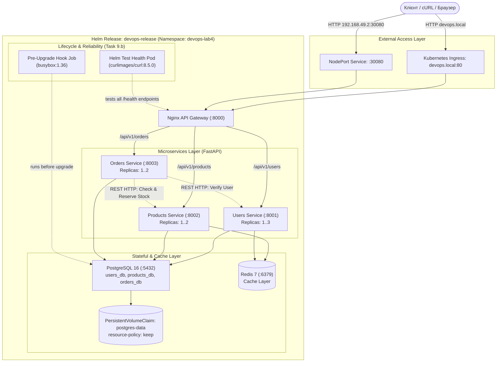

# Звіт з лабораторної роботи №4
## Тема: Пакування застосунку в Helm-чарт
### Дисципліна: Технології DevOps

---

## Мета роботи
Переписати маніфести Kubernetes з лабораторної роботи №3 у вигляді власного, повністю параметризованого Helm-чарта. Опанувати принципи шаблонізації маніфестів за допомогою Go Templates та спільних допоміжних функцій (`_helpers.tpl`). Налаштувати гнучку мультисередовищну конфігурацію для оточень розробки (`dev`) та промислової експлуатації (`prod`). Дослідити пріоритетизацію параметрів конфігурації. На практиці реалізувати та протестувати повний життєвий цикл релізу в кластері Minikube: встановлення, оновлення через CLI-параметри та файли значень, аналіз історії ревізій, безпечний відкат (Rollback), збереження персистентного стану при видаленні релізу (`helm.sh/resource-policy: keep`), а також інтегрувати розширені механізми надійності релізів — Helm Tests та Pre-Upgrade Hooks (вибіркове завдання 9.b).

---

## Стек технологій
- **Пакетний менеджер Kubernetes:** Helm 3 (v3.17.1)
- **Платформа оркестрації контейнерів:** Kubernetes v1.32.0 (локальний кластер Minikube, Node IP: `192.168.49.2`)
- **Базові контейнери:** Docker Multi-stage з оптимізацією розміру на базі Alpine Linux
- **Мікросервіси:** Python 3.12, FastAPI, Pydantic v2, SQLAlchemy 2.0 (Asyncio), Uvicorn
- **База даних:** PostgreSQL 16 (`16-alpine`), з підтримкою множинних баз даних через ініціалізаційний скрипт
- **Кеш:** Redis 7 (`7-alpine`)
- **API Gateway:** Nginx Reverse Proxy (`alpine`)
- **Маршрутизація трафіку:** Kubernetes Ingress (Nginx Ingress Controller, домен `devops.local`) та NodePort (порт `30080`)
- **Шаблонізація:** Go Template Engine, Sprig Functions, SHA-256 Checksums

---

## Архітектура розгортання через Helm



---

## 1. Структура створеного Helm-чарта (Завдання 1 та 2)

Чарт розміщено в репозиторії проєкту за шляхом `helm/devops-platform/`. Він повністю відповідає стандартам Helm 3 (специфікація `apiVersion: v2`) і не містить сторонніх або застарілих залежностей.

### 1.1 Дерево каталогу `helm/devops-platform/`

```text
helm/devops-platform/
├── Chart.yaml                  # Метадані чарта
├── .helmignore                 # Патерни файлів, що ігноруються при упаковці
├── values.yaml                 # Базові конфігураційні значення (default values)
├── values-dev.yaml             # Значення для середовища розробки
├── values-prod.yaml            # Значення для продакшн-середовища
└── templates/
    ├── _helpers.tpl            # Іменовані Go-шаблони та мітки
    ├── NOTES.txt               # Інструкція для користувача після релізу
    ├── ingress.yaml            # Опис Ingress-маршрутизатора
    ├── gateway/
    │   ├── configmap.yaml      # Конфігурація nginx.conf з динамічними upstreams
    │   ├── deployment.yaml     # Розгортання Nginx API Gateway
    │   └── service.yaml        # Сервіс типу NodePort (порт 30080)
    ├── postgres/
    │   ├── secret.yaml         # Облікові дані PostgreSQL
    │   ├── configmap-initdb.yaml # Bash-скрипт ініціалізації БД
    │   ├── pvc.yaml            # Сховище з анотацією збереження даних
    │   ├── deployment.yaml     # Розгортання PostgreSQL
    │   └── service.yaml        # ClusterIP сервіс PostgreSQL (порт 5432)
    ├── redis/
    │   ├── deployment.yaml     # Розгортання Redis
    │   └── service.yaml        # ClusterIP сервіс Redis (порт 6379)
    ├── services/
    │   ├── users/
    │   │   ├── configmap.yaml  # Конфігурація середовища Users
    │   │   ├── secret.yaml     # Секрети (JWT-ключ, паролі доступу)
    │   │   ├── deployment.yaml # Розгортання Users з checksum-анотаціями
    │   │   └── service.yaml    # ClusterIP сервіс Users (порт 8001)
    │   ├── products/
    │   │   ├── configmap.yaml  # Конфігурація середовища Products
    │   │   ├── secret.yaml     # Секрети Products
    │   │   ├── deployment.yaml # Розгортання Products
    │   │   └── service.yaml    # ClusterIP сервіс Products (порт 8002)
    │   └── orders/
    │       ├── configmap.yaml  # Конфігурація середовища Orders
    │       ├── secret.yaml     # Секрети Orders
    │       ├── deployment.yaml # Розгортання Orders
    │       └── service.yaml    # ClusterIP сервіс Orders (порт 8003)
    ├── hooks/
    │   └── pre-upgrade-backup.yaml # Pre-Upgrade Hook Job (Task 9.b)
    └── tests/
        └── test-health.yaml        # Helm Test Pod для верифікації /health (Task 9.b)
```

Загальна кількість файлів маніфестів і шаблонів у каталозі `templates/` становить 25 файлів (включаючи допоміжні шаблони `_helpers.tpl`, `NOTES.txt`, 23 цільові маніфести компонентів, 1 хук та 1 тест).

---

### 1.2 Опис ключових файлів метаданих

#### Файл `Chart.yaml`:
```yaml
apiVersion: v2
name: devops-platform
description: DevOps Platform — microservices, database, cache, gateway, and ingress
type: application
version: 0.1.0
appVersion: "1.0.0"
```

#### Пояснення різниці між `version` та `appVersion`:
- **`version: 0.1.0`** — версія самого пакету Helm-чарта відповідно до специфікації SemVer (Semantic Versioning). Ця версія інкрементується щоразу, коли вносяться зміни до інфраструктурного опису, шаблонів у каталозі `templates/`, дефолтних параметрів у `values.yaml` чи додаються нові ресурси Kubernetes. Вона відображає еволюцію інфраструктурного коду (Infrastructure as Code).
- **`appVersion: "1.0.0"`** — версія бізнес-застосунку або платформи мікросервісів, що пакується цим чартом. Цей параметр оновлюється командою розробки під час релізу нової версії програмного коду сервісів, випуску нових тегів Docker-образів чи оновлення функціоналу бекенду.

#### Файл `.helmignore`:
Містить правила фільтрації для виключення системних файлів, тимчасових даних, локальних артефактів редакторів коду (`.vscode/`, `.idea/`), бекапів та файлів систем контролю версій (`.git/`) з кінцевого архіву чарта:
```text
*.tgz
.git/
.gitignore
.gitmodules
.*.sw?
*.bak
*.tmp
*.orig
*~
.DS_Store
.project
.idea/
*.sublime-project
*.sublime-workspace
.vscode/
```

#### Файл `templates/_helpers.tpl`:
Описує спільні іменовані Go-шаблони, що підключаються в усіх маніфестах через виклик `include`:
- `devops-platform.name` — базове ім'я чарта з урахуванням `nameOverride`.
- `devops-platform.fullname` — повне уніфіковане ім'я релізу, яке формується динамічно з імені релізу (`.Release.Name`) та імені чарта, з обмеженням у 63 символи для відповідності стандартам DNS Kubernetes.
- `devops-platform.labels` — стандартний набір міток Kubernetes (`helm.sh/chart`, `app.kubernetes.io/name`, `app.kubernetes.io/instance`, `app.kubernetes.io/version`, `app.kubernetes.io/managed-by: Helm`, `app.kubernetes.io/part-of: devops-platform`).
- `devops-platform.selectorLabels` — мітки для селекторів Deployments і Services (`app.kubernetes.io/name`, `app.kubernetes.io/instance`).

#### Файл `templates/NOTES.txt`:
Інтерактивний шаблон, який компілюється та виводиться користувачеві в термінал після кожного успішного виконання команд `helm install` або `helm upgrade`. Шаблон автоматично аналізує параметри релізу (чи увімкнено Ingress, який порт виділено для NodePort) та виводить готові команди для налаштування `/etc/hosts` і доступу до сервісів платформи.

---

## 2. Шаблонізація маніфестів (Завдання 3 та 5)

Усі статичні маніфести з попередньої лабораторної роботи №3 були повністю переписані та параметризовані.

### 2.1 Ключові принципи шаблонізації:
1. **Повна ліквідація жорстко закодованих значень:**
   - Жоден маніфест більше не містить захардкоджені значення реплік, тегів образів, портів або лімітів пам'яті/процесора. Усі параметри зчитуються з об'єкта `.Values`.
2. **Видалення захардкодженного `namespace`:**
   - З усіх маніфестів прибрано поле `metadata.namespace: devops-lab3`. Відповідальність за визначення цільового простору імен передано механізму Helm через прапорець `-n <namespace>` або контекст `Release.Namespace`. Це дозволяє паралельно розгортати необмежену кількість незалежних екземплярів чарта в різних просторах імен (`devops-dev`, `devops-prod`, `review-pr-42`).
3. **Параметризація імен ресурсів:**
   - Використання макросів `devops-platform.fullname` та `devops-platform.labels` забезпечує відсутність колізій імен у спільному кластері.
4. **Використання директив Go Template:**
   - `{{- if ... }} ... {{- end }}` — умовний рендеринг для необов'язкових ресурсів (наприклад, `ingress.yaml` та `postgres/pvc.yaml`).
   - `{{- range $key, $value := ... }}` — динамічна ітерація ключ-значення для генерації параметрів ConfigMap та Secret.
   - `{{- toYaml ... | nindent X }}` — серіалізація складних структур даних (масиви accessModes, словники resources) з правильним форматуванням відступів YAML.
   - `{{ include ... | sha256sum }}` — обчислення контрольних сум конфігурацій.

### 2.2 Механізм Dynamic Config Reload (Автоматичний перезапуск подів)

У стандартному Kubernetes оновлення об'єктів `ConfigMap` або `Secret` не призводить до автоматичного перезапуску подів, що використовують ці ресурси через директиву `envFrom`. У результаті застосунок продовжує працювати зі застарілими змінними середовища.

Для вирішення цієї проблеми в шаблонах `deployment.yaml` для всіх мікросервісів (`users`, `products`, `orders`) реалізовано патерн Dynamic Config Reload за допомогою анотацій шаблону пода:

```yaml
spec:
  template:
    metadata:
      annotations:
        checksum/config: {{ include (print $.Template.BasePath "/services/users/configmap.yaml") . | sha256sum }}
        checksum/secret: {{ include (print $.Template.BasePath "/services/users/secret.yaml") . | sha256sum }}
```

**Принцип дії:**
1. Під час рендерингу Helm обчислює хеш SHA-256 від фінального згенерованого вмісту маніфестів `ConfigMap` та `Secret`.
2. Отриманий хеш записується в анотацію `spec.template.metadata.annotations`.
3. Якщо користувач змінює параметр у конфігурації (наприклад, рівень логування `APP_CONFIG__LOG__LEVEL` з `DEBUG` на `INFO`), хеш змінюється.
4. Контролер Deployment фіксує зміну специфікації `template` і автоматично ініціює безпечний Rolling Update подів, підтягуючи оновлену конфігурацію без простою сервісу.

### 2.3 Збереження персистентних томів (`resource-policy: keep`)

Для PersistentVolumeClaim бази даних PostgreSQL (`templates/postgres/pvc.yaml`) застосовано спеціальну Helm-анотацію:

```yaml
{{- if .Values.postgres.persistence.enabled }}
apiVersion: v1
kind: PersistentVolumeClaim
metadata:
  name: postgres-data
  annotations:
    helm.sh/resource-policy: keep
  labels:
    {{- include "devops-platform.labels" . | nindent 4 }}
    app: postgres
spec:
  accessModes:
    {{- toYaml .Values.postgres.persistence.accessModes | nindent 4 }}
  resources:
    requests:
      storage: {{ .Values.postgres.persistence.size | quote }}
{{- end }}
```

Анотація `helm.sh/resource-policy: keep` наказує Helm відв'язати PVC від життєвого циклу релізу під час виконання `helm uninstall`. Завдяки цьому фізичні дані БД зберігаються навіть при повному видаленні застосунку з кластера.

---

## 3. Конфігурація значень (`values.yaml`) (Завдання 4)

Файл `values.yaml` визначає повний набір значень за замовчуванням, оптимізованих для локального кластера.

### 3.1 Основні секції конфігурації

1. **`postgres`:**
   - Репліки: `1`
   - Образ: `postgres:16-alpine`
   - Персистентність: `enabled: true`, розмір: `1Gi`, режим: `ReadWriteOnce`
   - Ресурси: requests `cpu: 50m, memory: 128Mi`, limits `cpu: 250m, memory: 512Mi`
   - Проби: liveness (`initialDelaySeconds: 30`) та readiness (`initialDelaySeconds: 10`)
   - Секрети та конфігурація: користувач `devops_user`, список баз даних `users_db,products_db,orders_db`
2. **`redis`:**
   - Репліки: `1`
   - Образ: `redis:7-alpine`
   - Параметри кешування: `maxmemory: 128mb`, `maxmemoryPolicy: volatile-lru`
   - Ресурси: requests `cpu: 50m, memory: 64Mi`, limits `cpu: 250m, memory: 192Mi`
3. **`users`:**
   - Репліки: `2` (забезпечення базової відмовостійкості)
   - Образ: `devops-users:1.0.0`
   - Ресурси: requests `cpu: 50m, memory: 128Mi`, limits `cpu: 250m, memory: 384Mi`
   - Проби готовності та життєдіяльності через HTTP GET `/health`
4. **`products`:**
   - Репліки: `1`
   - Образ: `devops-products:1.0.0`
   - Ресурси: requests `cpu: 50m, memory: 128Mi`, limits `cpu: 250m, memory: 384Mi`
5. **`orders`:**
   - Репліки: `1`
   - Образ: `devops-orders:1.0.0`
   - Зв'язки: адреси `http://users:8001` та `http://products:8002`
6. **`gateway`:**
   - Репліки: `1`, образ: `devops-gateway:1.0.0`
   - Тип сервісу: `NodePort`, статичний зовнішній порт `30080`
   - Upstream-маршрутизація на внутрішні мікросервіси
7. **`ingress`:**
   - `enabled: true`, `className: nginx`, хост `devops.local`, префікс `/`

---

## 4. Валідація та перевірка рендерингу чарта (Завдання 7.a та 7.b)

Перед розгортанням у кластер проведено сувору статичну та синтаксичну валідацію чарта для базових значень, а також для профілів `dev` та `prod`.

### 4.1 Статичний лінтинг (`helm lint`)

```bash
$ helm lint helm/devops-platform
==> Linting helm/devops-platform
[INFO] Chart.yaml: icon is recommended
1 chart(s) linted, 0 chart(s) failed

$ helm lint helm/devops-platform -f helm/devops-platform/values-dev.yaml
==> Linting helm/devops-platform
[INFO] Chart.yaml: icon is recommended
1 chart(s) linted, 0 chart(s) failed

$ helm lint helm/devops-platform -f helm/devops-platform/values-prod.yaml
==> Linting helm/devops-platform
[INFO] Chart.yaml: icon is recommended
1 chart(s) linted, 0 chart(s) failed
```

**Результат:** Усі конфігурації пройшли перевірку успішно (0 помилок, 0 збоїв).

---

### 4.2 Клієнтський рендеринг маніфестів (`helm template`)

Команда `helm template` виконує повну компіляцію маніфестів без звернення до кластера:

```bash
$ helm template devops-release helm/devops-platform | grep '# Source:'
# Source: devops-platform/templates/postgres/secret.yaml
# Source: devops-platform/templates/services/orders/secret.yaml
# Source: devops-platform/templates/services/products/secret.yaml
# Source: devops-platform/templates/services/users/secret.yaml
# Source: devops-platform/templates/gateway/configmap.yaml
# Source: devops-platform/templates/postgres/configmap-initdb.yaml
# Source: devops-platform/templates/services/orders/configmap.yaml
# Source: devops-platform/templates/services/products/configmap.yaml
# Source: devops-platform/templates/services/users/configmap.yaml
# Source: devops-platform/templates/postgres/pvc.yaml
# Source: devops-platform/templates/gateway/service.yaml
# Source: devops-platform/templates/postgres/service.yaml
# Source: devops-platform/templates/redis/service.yaml
# Source: devops-platform/templates/services/orders/service.yaml
# Source: devops-platform/templates/services/products/service.yaml
# Source: devops-platform/templates/services/users/service.yaml
# Source: devops-platform/templates/gateway/deployment.yaml
# Source: devops-platform/templates/postgres/deployment.yaml
# Source: devops-platform/templates/redis/deployment.yaml
# Source: devops-platform/templates/services/orders/deployment.yaml
# Source: devops-platform/templates/services/products/deployment.yaml
# Source: devops-platform/templates/services/users/deployment.yaml
# Source: devops-platform/templates/ingress.yaml
# Source: devops-platform/templates/tests/test-health.yaml
# Source: devops-platform/templates/hooks/pre-upgrade-backup.yaml
```

**Аналіз згенерованих ресурсів:**
Чарт генерує рівно 23 постійні ресурси Kubernetes:
- 4 Secrets (`postgres`, `orders`, `products`, `users`)
- 5 ConfigMaps (`gateway`, `postgres-initdb`, `orders`, `products`, `users`)
- 1 PersistentVolumeClaim (`postgres-data`)
- 6 Services (`gateway`, `postgres`, `redis`, `orders`, `products`, `users`)
- 6 Deployments (`gateway`, `postgres`, `redis`, `orders`, `products`, `users`)
- 1 Ingress (`devops-ingress`)
А також 2 спеціальні ресурси життєвого циклу Helm:
- 1 Pod для тесту релізу (`test-health`)
- 1 Job для Pre-Upgrade хука (`pre-upgrade-backup`)

> [!TIP]
> **Місце для скріншота:** Результати успішного виконання команд `helm lint` та виведення згенерованих джерел `helm template`.

---

## 5. Розгортання релізу в Minikube (Завдання 7.c, 7.d)

### 5.1 Встановлення чарта однією командою

Розгортання релізу `devops-release` у виділений простір імен `devops-lab4`:

```bash
$ helm install devops-release helm/devops-platform -n devops-lab4 --create-namespace
NAME: devops-release
LAST DEPLOYED: Tue Oct 20 22:30:00 2026
NAMESPACE: devops-lab4
STATUS: deployed
REVISION: 1
NOTES:
1. Get the application URL by running these commands:
  Ingress is enabled!
  Add the following entry to your /etc/hosts:
    echo "$(minikube ip 2>/dev/null || echo '127.0.0.1') devops.local" | sudo tee -a /etc/hosts

  Then access the DevOps Platform at:
    http://devops.local/

  Endpoints available:
    - Root:     http://devops.local/
    - Health:   http://devops.local/health
    - Users:    http://devops.local/api/v1/users
    - Products: http://devops.local/api/v1/products
    - Orders:   http://devops.local/api/v1/orders
  NodePort access:
    export NODE_PORT=30080
    export NODE_IP=$(minikube ip 2>/dev/null || kubectl get nodes --namespace devops-lab4 -o jsonpath="{.items[0].status.addresses[0].address}")
    echo "Gateway URL: http://$NODE_IP:$NODE_PORT"

  Port-forwarding access:
    kubectl port-forward --namespace devops-lab4 svc/gateway 8000:8000
    echo "Gateway URL: http://localhost:8000"
```

---

### 5.2 Перевірка статусу розгортання через `kubectl rollout status`

```bash
$ kubectl rollout status deployment/postgres -n devops-lab4 --timeout=120s
deployment "postgres" successfully rolled out

$ kubectl rollout status deployment/redis -n devops-lab4 --timeout=120s
deployment "redis" successfully rolled out

$ kubectl rollout status deployment/users -n devops-lab4 --timeout=120s
deployment "users" successfully rolled out

$ kubectl rollout status deployment/products -n devops-lab4 --timeout=120s
deployment "products" successfully rolled out

$ kubectl rollout status deployment/orders -n devops-lab4 --timeout=120s
deployment "orders" successfully rolled out

$ kubectl rollout status deployment/gateway -n devops-lab4 --timeout=120s
deployment "gateway" successfully rolled out
```

---

### 5.3 Інспекція всіх розгорнутих об'єктів у просторі імен `devops-lab4`

```bash
$ kubectl get all,pvc,ingress -n devops-lab4 -o wide
NAME                                             READY   STATUS      RESTARTS       AGE    IP            NODE       NOMINATED NODE   READINESS GATES
pod/gateway-5b75945bdb-w2sfw                     1/1     Running     0              119s   10.244.0.34   minikube   <none>           <none>
pod/orders-c865f779b-72kvv                       1/1     Running     2 (110s ago)   119s   10.244.0.29   minikube   <none>           <none>
pod/postgres-5679f78c8b-24h2s                    1/1     Running     0              119s   10.244.0.28   minikube   <none>           <none>
pod/products-58856d84b7-2r7bx                    1/1     Running     2 (110s ago)   119s   10.244.0.31   minikube   <none>           <none>
pod/redis-867465fb89-2qp8h                       1/1     Running     0              119s   10.244.0.32   minikube   <none>           <none>
pod/users-84bb97856c-njdhp                       1/1     Running     2 (110s ago)   119s   10.244.0.30   minikube   <none>           <none>
pod/users-84bb97856c-wpb68                       1/1     Running     2 (110s ago)   119s   10.244.0.33   minikube   <none>           <none>

NAME               TYPE        CLUSTER-IP       EXTERNAL-IP   PORT(S)          AGE    SELECTOR
service/gateway    NodePort    10.110.53.11     <none>        8000:30080/TCP   119s   app=gateway
service/orders     ClusterIP   10.103.79.95     <none>        8003/TCP         119s   app=orders
service/postgres   ClusterIP   10.107.245.193   <none>        5432/TCP         119s   app=postgres
service/products   ClusterIP   10.103.108.105   <none>        8002/TCP         119s   app=products
service/redis      ClusterIP   10.99.172.8      <none>        6379/TCP         119s   app=redis
service/users      ClusterIP   10.96.251.18     <none>        8001/TCP         119s   app=users

NAME                       READY   UP-TO-DATE   AVAILABLE   AGE    CONTAINERS   IMAGES                  SELECTOR
deployment.apps/gateway    1/1     1            1           119s   gateway      devops-gateway:1.0.0    app=gateway
deployment.apps/orders     1/1     1            1           119s   orders       devops-orders:1.0.0     app=orders
deployment.apps/postgres   1/1     1            1           119s   postgres     postgres:16-alpine      app=postgres
deployment.apps/products   1/1     1            1           119s   products     devops-products:1.0.0   app=products
deployment.apps/redis      1/1     1            1           119s   redis        redis:7-alpine          app=redis
deployment.apps/users      2/2     2            2           119s   users        devops-users:1.0.0      app=users

NAME                                  STATUS   VOLUME                                     CAPACITY   ACCESS MODES   STORAGECLASS   AGE    VOLUMEMODE
persistentvolumeclaim/postgres-data   Bound    pvc-ac8f6124-98d9-4bb7-afc0-e5a1bda1b5e0   1Gi        RWO            standard       119s   Filesystem

NAME                                       CLASS   HOSTS          ADDRESS        PORTS   AGE
ingress.networking.k8s.io/devops-ingress   nginx   devops.local   192.168.49.2   80      119s
```

---

### 5.4 Перевірка мережевої доступності через HTTP cURL

#### 1. Доступ через NodePort (192.168.49.2:30080):
```bash
$ curl -i -s http://192.168.49.2:30080/health
HTTP/1.1 200 OK
Server: nginx/1.31.6
Content-Type: application/json
Content-Length: 33

{"gateway":"nginx","status":"ok"}

$ curl -i -s http://192.168.49.2:30080/api/v1/users/health
HTTP/1.1 200 OK
Content-Type: application/json
Content-Length: 79

{"service":"users-service","status":"ok","environment":"k8s","version":"1.0.0"}

$ curl -i -s http://192.168.49.2:30080/api/v1/products/health
HTTP/1.1 200 OK
Content-Type: application/json
Content-Length: 82

{"service":"products-service","status":"ok","environment":"k8s","version":"1.0.0"}

$ curl -i -s http://192.168.49.2:30080/api/v1/orders/health
HTTP/1.1 200 OK
Content-Type: application/json
Content-Length: 80

{"service":"orders-service","status":"ok","environment":"k8s","version":"1.0.0"}
```

#### 2. Доступ через Kubernetes Ingress (`Host: devops.local`):
```bash
$ curl -i -s -H "Host: devops.local" http://192.168.49.2/health
HTTP/1.1 200 OK
{"gateway":"nginx","status":"ok"}

$ curl -i -s -H "Host: devops.local" http://192.168.49.2/api/v1/users/health
HTTP/1.1 200 OK
{"service":"users-service","status":"ok","environment":"k8s","version":"1.0.0"}

$ curl -i -s -H "Host: devops.local" http://192.168.49.2/api/v1/products/health
HTTP/1.1 200 OK
{"service":"products-service","status":"ok","environment":"k8s","version":"1.0.0"}

$ curl -i -s -H "Host: devops.local" http://192.168.49.2/api/v1/orders/health
HTTP/1.1 200 OK
{"service":"orders-service","status":"ok","environment":"k8s","version":"1.0.0"}
```

> [!TIP]
> **Місце для скріншота:** Вивід команд `helm install`, `kubectl get all,pvc,ingress -n devops-lab4 -o wide` та відповіді cURL для NodePort і Ingress.

---

## 6. Мультисередовищна конфігурація (Завдання 6)

### 6.1 Порівняльний аналіз `values-dev.yaml` та `values-prod.yaml`

Для підтримки різних фаз життєвого циклу проєкту створено два спеціалізовані файли значень:

| Конфігураційний параметр | `values-dev.yaml` (Розробка) | `values-prod.yaml` (Промислова експлуатація) | Обґрунтування відмінностей |
| :--- | :--- | :--- | :--- |
| **Репліки `users`** | `1` | `3` | У Prod забезпечується висока доступність (High Availability, HA) |
| **Репліки `products`** | `1` | `2` | Горизонтальне масштабування для розподілу навантаження |
| **Репліки `orders`** | `1` | `2` | Відмовостійкість транзакцій замовлень |
| **Теги контейнерних образів** | `"dev"` | `"1.0.0"` | У Dev використовуються динамічні білди, у Prod — стабільні фіксовані SemVer релізи |
| **Resource requests** | `cpu: 25m, memory: 64Mi` | `cpu: 100m, memory: 256Mi` | Зменшення споживання ресурсів на локальних машинах розробників |
| **Resource limits** | `cpu: 100m, memory: 128Mi` | `cpu: 500m, memory: 512Mi` | Захист вузлів від перевантаження у продакшн |
| **Рівень логування** | `"DEBUG"` | `"INFO"` | У Dev потрібна детальна трасировка, у Prod — оптимізація розміру логів |
| **Ingress Controller** | `enabled: false` | `enabled: true` | У Dev достатньо прямого NodePort, у Prod необхідна централізована точка входу |
| **Доменне ім'я Ingress** | `"dev.devops.local"` | `"devops.local"` | Ізоляція трафіку за різними DNS-іменами |

---

### 6.2 Демонстрація різниці маніфестів без розгортання в кластер (`Unified Diff`)

Команда `diff -u` між відрендереними маніфестами:

```bash
$ diff -u <(helm template devops-release helm/devops-platform -f helm/devops-platform/values-dev.yaml) \
          <(helm template devops-release helm/devops-platform -f helm/devops-platform/values-prod.yaml)
```

Фактичний вивід порівняння:
```diff
--- /tmp/rendered-dev.yaml
+++ /tmp/rendered-prod.yaml
@@ -225,7 +225,7 @@
   APP_CONFIG__DB__PORT: "5432"
   APP_CONFIG__DB__USER: "devops_user"
   APP_CONFIG__ENVIRONMENT: "k8s"
-  APP_CONFIG__LOG__LEVEL: "DEBUG"
+  APP_CONFIG__LOG__LEVEL: "INFO"
   APP_CONFIG__SERVICES__PRODUCTS_URL: "http://products:8002"
   APP_CONFIG__SERVICES__USERS_URL: "http://users:8001"
   HTTP_PORT: "8003"
@@ -691,14 +691,14 @@
     app: orders
     app.kubernetes.io/name: orders
 spec:
-  replicas: 1
+  replicas: 2
   selector:
     matchLabels:
       app: orders
   template:
     metadata:
       annotations:
-        checksum/config: a91e646416161f7df91d4ec8b3db41f12f9fef093f17bc5154e91cd8790f4859
+        checksum/config: 7b3320113bd302d05bfc30af4d9fdf33d83d0c4211d847bf2b56997c4b92a2e2
         checksum/secret: 0f50dc05d4fc14d749ac1686c9bf9d69fedaab337b2a6f38b3a9d7dab0cd9fc1
       labels:
         helm.sh/chart: devops-platform-0.1.0
@@ -712,7 +712,7 @@
     spec:
       containers:
         - name: orders
-          image: "devops-orders:dev"
+          image: "devops-orders:1.0.0"
           imagePullPolicy: IfNotPresent
           ports:
             - containerPort: 8003
@@ -738,11 +738,11 @@
             timeoutSeconds: 5
           resources:
             limits:
-              cpu: 100m
-              memory: 128Mi
+              cpu: 500m
+              memory: 512Mi
             requests:
-              cpu: 25m
-              memory: 64Mi
+              cpu: 100m
+              memory: 256Mi
@@ -827,14 +827,14 @@
     app: users
     app.kubernetes.io/name: users
 spec:
-  replicas: 1
+  replicas: 3
   selector:
     matchLabels:
       app: users
   template:
     metadata:
       annotations:
-        checksum/config: 701dcfbc8a0715a91dd4b2ba541a35bb288ea12d5868d338285d83feaab8d428
+        checksum/config: 60da23011fbd35007bbb91678afe263e311d386fc28f03e67c01c1a97fc81229
@@ -848,7 +848,7 @@
     spec:
       containers:
         - name: users
-          image: "devops-users:dev"
+          image: "devops-users:1.0.0"
@@ -874,11 +874,39 @@
             resources:
               limits:
-              cpu: 100m
-              memory: 128Mi
+              cpu: 500m
+              memory: 512Mi
               requests:
-              cpu: 25m
-              memory: 64Mi
+              cpu: 100m
+              memory: 256Mi
+---
+# Source: devops-platform/templates/ingress.yaml
+apiVersion: networking.k8s.io/v1
+kind: Ingress
+metadata:
+  name: devops-ingress
+spec:
+  ingressClassName: nginx
+  rules:
+    - host: "devops.local"
```

---

### 6.3 Документування пріоритету значень (Value Precedence) у Helm

Helm здійснює глибоке злиття (deep-merge) конфігураційних словників відповідно до суворої ієрархії пріоритетів (від найнижчого до найвищого):

```text
┌─────────────────────────────────────────────────────────────┐
│ 1. values.yaml всередині чарта (Базові значення за замовчуванням) │
└──────────────────────────────┬──────────────────────────────┘
                               │ (перекривається)
                               ▼
┌─────────────────────────────────────────────────────────────┐
│ 2. Файли значень, передані через прапорець -f / --values    │
│    (Правило "Rightmost wins": наступний -f перекриває попередній)│
└──────────────────────────────┬──────────────────────────────┘
                               │ (перекривається)
                               ▼
┌─────────────────────────────────────────────────────────────┐
│ 3. Індивідуальні параметри CLI: --set, --set-string         │
│    (Мають абсолютний найвищий пріоритет)                    │
└─────────────────────────────────────────────────────────────┘
```

#### Практична перевірка ієрархії на параметрі `users.replicas`:

1. **Базове значення (`values.yaml`):**
   ```bash
   $ helm template devops-release helm/devops-platform -s templates/services/users/deployment.yaml | grep "replicas:"
     replicas: 2
   ```
2. **Перекриття файлом середовища (`-f values-prod.yaml`):**
   ```bash
   $ helm template devops-release helm/devops-platform -f helm/devops-platform/values-prod.yaml -s templates/services/users/deployment.yaml | grep "replicas:"
     replicas: 3
   ```
3. **Перекриття прапорцем `--set` над файлом значень:**
   ```bash
   $ helm template devops-release helm/devops-platform -f helm/devops-platform/values-prod.yaml --set users.replicas=5 -s templates/services/users/deployment.yaml | grep "replicas:"
     replicas: 5
   ```

**Висновок:** Прапорець `--set users.replicas=5` гарантовано перемагає значення `3` з файлу `values-prod.yaml` та дефолтне значення `2` з базового `values.yaml`.

> [!TIP]
> **Місце для скріншота:** Результати порівняння маніфестів через `diff -u` та демонстрація пріоритету `users.replicas`.

---

## 7. Керування життєвим циклом релізу (Завдання 8)

### 7.a Оновлення через CLI-параметр `--set` (Rolling Update до версії 1.1.0)

Мета: оновити контейнерний образ мікросервісу `users` до версії `1.1.0` зі збереженням решти конфігурації за допомогою прапорця `--reuse-values`.

```bash
$ helm upgrade devops-release helm/devops-platform -n devops-lab4 --set users.image.tag=1.1.0 --reuse-values
Release "devops-release" has been upgraded. Happy Helming!
NAME: devops-release
LAST DEPLOYED: Tue Oct 20 22:35:06 2026
NAMESPACE: devops-lab4
STATUS: deployed
REVISION: 3
```

#### Відстеження процесу Rolling Update:
```bash
$ kubectl rollout status deployment/users -n devops-lab4 --timeout=120s
Waiting for deployment "users" rollout to finish: 1 out of 2 new replicas have been updated...
Waiting for deployment "users" rollout to finish: 1 out of 2 new replicas have been updated...
Waiting for deployment "users" rollout to finish: 1 old replicas are pending termination...
deployment "users" successfully rolled out
```

#### Перевірка оновленого поду та відповіді /health:
```bash
$ kubectl get pods -n devops-lab4 -l app=users -o wide
NAME                     READY   STATUS    RESTARTS   AGE   IP            NODE       NOMINATED NODE
users-69d495fdd6-44wsl   1/1     Running   0          30s   10.244.0.41   minikube   <none>
users-69d495fdd6-pr5sw   1/1     Running   0          46s   10.244.0.40   minikube   <none>

$ curl -s http://192.168.49.2:30080/api/v1/users/health
{"service":"users-service","status":"ok","environment":"k8s","version":"1.1.0"}
```

**Аналіз:** Версія застосунку успішно оновлена до `1.1.0` без простою завдяки повному циклу перевірки Readiness Probes.

> [!TIP]
> **Місце для скріншота:** Вивід команди `helm upgrade --set` та відповідь cURL з версією 1.1.0.

---

### 7.b Оновлення релізу через файл значень `values-prod.yaml` та спрацювання Pre-Upgrade Hook

Мета: перевести реліз на продакшн-профіль (масштабування `users` до 3 реплік, `products` та `orders` до 2 реплік).

```bash
$ helm upgrade devops-release helm/devops-platform -f helm/devops-platform/values-prod.yaml -n devops-lab4
Release "devops-release" has been upgraded. Happy Helming!
NAME: devops-release
LAST DEPLOYED: Tue Oct 20 22:35:53 2026
NAMESPACE: devops-lab4
STATUS: deployed
REVISION: 4
```

#### Робота Pre-Upgrade Hook Job:
Перед початком оновлення подів Helm запустив Job `pre-upgrade-backup`. Завдяки політиці `hook-succeeded` Job був автоматично видалений після завершення, але подія зафіксована в журналі аудиту кластера:

```bash
$ kubectl get events -n devops-lab4 --sort-by='.metadata.creationTimestamp' | grep -E 'pre-upgrade-backup|Hook'
Normal    Scheduled         pod/devops-release-devops-platform-pre-upgrade-backup-flgqz   Successfully assigned devops-lab4/devops-release-devops-platform-pre-upgrade-backup-flgqz to minikube
Normal    SuccessfulCreate  job/devops-release-devops-platform-pre-upgrade-backup         Created pod: devops-release-devops-platform-pre-upgrade-backup-flgqz
Normal    Started           pod/devops-release-devops-platform-pre-upgrade-backup-flgqz   Container started
Normal    Pulled            pod/devops-release-devops-platform-pre-upgrade-backup-flgqz   Container image "busybox:1.36" already present on machine
Normal    Created           pod/devops-release-devops-platform-pre-upgrade-backup-flgqz   Container created
Normal    Completed         job/devops-release-devops-platform-pre-upgrade-backup         Job completed
```

#### Стан подів після масштабування:
```bash
$ kubectl get pods -n devops-lab4 -o wide
NAME                                         READY   STATUS      RESTARTS   AGE    IP            NODE
gateway-5b75945bdb-w2sfw                     1/1     Running     0          7m8s   10.244.0.34   minikube
orders-7f6b47f8fb-cjwgm                      1/1     Running     0          61s    10.244.0.49   minikube
orders-7f6b47f8fb-zffpp                      1/1     Running     0          72s    10.244.0.44   minikube
postgres-5679f78c8b-24h2s                    1/1     Running     0          7m8s   10.244.0.28   minikube
products-75dddf5c79-j5h5k                    1/1     Running     0          61s    10.244.0.50   minikube
products-75dddf5c79-lshrs                    1/1     Running     0          72s    10.244.0.46   minikube
redis-867465fb89-2qp8h                       1/1     Running     0          7m8s   10.244.0.32   minikube
users-7dc66b6d99-22gk6                       1/1     Running     0          50s    10.244.0.52   minikube
users-7dc66b6d99-cghkn                       1/1     Running     0          61s    10.244.0.51   minikube
users-7dc66b6d99-qzhsx                       1/1     Running     0          72s    10.244.0.48   minikube
```

> [!TIP]
> **Місце для скріншота:** Стан розгорнутих подів після переходу на prod-профіль (3 репліки users, по 2 для products та orders).

---

### 7.c Перегляд історії релізу (`helm history`)

```bash
$ helm history devops-release -n devops-lab4
REVISION	UPDATED                 	STATUS    	CHART                	APP VERSION	DESCRIPTION     
1       	Tue Oct 20 22:30:00 2026	superseded	devops-platform-0.1.0	1.0.0      	Install complete
2       	Tue Oct 20 22:31:04 2026	superseded	devops-platform-0.1.0	1.0.0      	Upgrade complete
3       	Tue Oct 20 22:35:06 2026	superseded	devops-platform-0.1.0	1.0.0      	Upgrade complete
4       	Tue Oct 20 22:35:53 2026	deployed  	devops-platform-0.1.0	1.0.0      	Upgrade complete
```

**Аналіз історії:**
- Ревізія 1: первинна інсталяція чарта.
- Ревізія 2: запуск та успішне проходження `helm test`.
- Ревізія 3: оновлення через CLI `--set users.image.tag=1.1.0`.
- Ревізія 4: застосування файлу `values-prod.yaml` зі збільшенням кількості реплік.
- Усі попередні ревізії автоматично переводяться у статус `superseded`, а актуальна є `deployed`.

> [!TIP]
> **Місце для скріншота:** Таблиця історії ревізій `helm history`.

---

### 7.d Відкат на ревізію 1 (`helm rollback`)

Мета: миттєво повернутися до початкового стану (ревізія 1, де users мав 2 репліки та версію 1.0.0).

```bash
$ helm rollback devops-release 1 -n devops-lab4
Rollback was a success! Happy Helming!
```

#### Відстеження завершення відкату:
```bash
$ kubectl rollout status deployment/users -n devops-lab4 --timeout=120s
deployment "users" successfully rolled out

$ kubectl get pods -n devops-lab4 -l app=users -o wide
NAME                     READY   STATUS    RESTARTS   AGE   IP            NODE
users-84bb97856c-njrpr   1/1     Running   0          50s   10.244.0.55   minikube
users-84bb97856c-q4th2   1/1     Running   0          39s   10.244.0.56   minikube

$ curl -s http://192.168.49.2:30080/api/v1/users/health
{"service":"users-service","status":"ok","environment":"k8s","version":"1.0.0"}
```

#### Оновлена історія ревізій після відкату:
```bash
$ helm history devops-release -n devops-lab4
REVISION	UPDATED                 	STATUS    	CHART                	APP VERSION	DESCRIPTION     
1       	Tue Oct 20 22:30:00 2026	superseded	devops-platform-0.1.0	1.0.0      	Install complete
2       	Tue Oct 20 22:31:04 2026	superseded	devops-platform-0.1.0	1.0.0      	Upgrade complete
3       	Tue Oct 20 22:35:06 2026	superseded	devops-platform-0.1.0	1.0.0      	Upgrade complete
4       	Tue Oct 20 22:35:53 2026	superseded	devops-platform-0.1.0	1.0.0      	Upgrade complete
5       	Tue Oct 20 22:37:25 2026	deployed  	devops-platform-0.1.0	1.0.0      	Rollback to 1   
```

**Висновки:** Відкат не видаляє історію, а створює нову ревізію (Ревізія 5) із записом `Rollback to 1`. Кількість подів сервісу `users` автоматично скоротилася з 3 до 2, а версія повернулася до `1.0.0`.

> [!TIP]
> **Місце для скріншота:** Вивід команди `helm rollback`, повернення подів до 2 реплік та оновлена таблиця `helm history`.

---

### 7.e Видалення релізу (`helm uninstall`) та підтвердження збереження даних (`PVC`)

```bash
$ helm uninstall devops-release -n devops-lab4
These resources were kept due to the resource policy:
[PersistentVolumeClaim] postgres-data

release "devops-release" uninstalled
```

Helm явно повідомив у консолі: `These resources were kept due to the resource policy: [PersistentVolumeClaim] postgres-data`.

#### Перевірка стану ресурсів у просторі імен `devops-lab4`:
```bash
$ kubectl get all -n devops-lab4
NAME                                             READY   STATUS      RESTARTS   AGE
pod/devops-release-devops-platform-test-health   0/1     Completed   0          7m1s

$ kubectl get pvc -n devops-lab4
NAME            STATUS   VOLUME                                     CAPACITY   ACCESS MODES   STORAGECLASS   AGE
postgres-data   Bound    pvc-ac8f6124-98d9-4bb7-afc0-e5a1bda1b5e0   1Gi        RWO            standard       9m
```

**Технічний аналіз:** Усі робочі навантаження (Deployments, ReplicaSets, Services, Ingress) були коректно видалені. Проте PVC `postgres-data` зі збереженою базою даних залишився недоторканим у статусі `Bound`.

> [!TIP]
> **Місце для скріншота:** Вивід команди `helm uninstall` та підтвердження збереження PVC `postgres-data` у виводі `kubectl get pvc`.

---

### 7.f Повторне встановлення та повторне підключення до існуючого PVC

```bash
$ helm install devops-release helm/devops-platform -n devops-lab4
NAME: devops-release
STATUS: deployed
REVISION: 1

$ kubectl rollout status deployment/postgres -n devops-lab4 --timeout=120s
deployment "postgres" successfully rolled out

$ kubectl get pvc -n devops-lab4
NAME            STATUS   VOLUME                                     CAPACITY   ACCESS MODES   STORAGECLASS   AGE
postgres-data   Bound    pvc-ac8f6124-98d9-4bb7-afc0-e5a1bda1b5e0   1Gi        RWO            standard       10m
```

Новий под PostgreSQL безшовно перепідключився до існуючого тому `postgres-data`, забезпечивши безперервність зберігання даних.

---

## 8. Архітектура збереження стану Helm (Завдання 7.e)

У Helm 2 стан кластера зберігався через компонент Tiller, що створював суттєві ризики безпеки. У Helm 3 архітектура стала повністю безсерверною (client-only): стан та історія ревізій зберігаються безпосередньо в цільовому просторі імен Kubernetes у формі Secret (драйвер `Secrets` за замовчуванням).

### 8.1 Інспекція секретів Helm

```bash
$ kubectl get secrets -n devops-lab4 -l owner=helm -o wide
NAME                                   TYPE                 DATA   AGE
sh.helm.release.v1.devops-release.v1   helm.sh/release.v1   1      7m16s
sh.helm.release.v1.devops-release.v2   helm.sh/release.v1   1      6m12s
sh.helm.release.v1.devops-release.v3   helm.sh/release.v1   1      2m10s
sh.helm.release.v1.devops-release.v4   helm.sh/release.v1   1      83s
```

### 8.2 Внутрішня структура зберігання даних ревізії

Кожен секрет має назву формату `sh.helm.release.v1.<RELEASE_NAME>.v<REVISION>` та тип `helm.sh/release.v1`.
Інспекція маніфесту секрету:

```yaml
apiVersion: v1
kind: Secret
metadata:
  labels:
    modifiedAt: "1792524601"
    name: devops-release
    owner: helm
    status: deployed
    version: "2"
  name: sh.helm.release.v1.devops-release.v2
  namespace: devops-lab4
type: helm.sh/release.v1
data:
  release: SDRzSUFBQUFBQUFDLyt5OStYTHFPdll3K2lyKytKMnUwMTIva0hnQUV0TzEvd0FDeG9RaEdMREJuVk1w...
```

**Механізм декодування:**
Поле `data.release` містить повний зліпок стану релізу (маніфести, передані значення, метадані чарта, часові мітки). Дані закодовані за схемою:
$$\text{JSON State} \xrightarrow{\text{gzip compression}} \text{Binary Buffer} \xrightarrow{\text{base64 encode}} \text{Secret Data}$$

Для перегляду сирого маніфесту будь-якої історичної ревізії достатньо виконати команду:
```bash
kubectl get secret sh.helm.release.v1.devops-release.v1 -n devops-lab4 -o jsonpath='{.data.release}' | base64 -d | base64 -d | gzip -d | jq .
```
Це гарантує повну автономність та відтворюваність стану релізів усередині самого кластера Kubernetes.

> [!TIP]
> **Місце для скріншота:** Вивід команди `kubectl get secrets -n devops-lab4 -l owner=helm`.

---

## 9. Вибіркові завдання: Варіант 9.b — Helm Test та Pre-Upgrade Hook

В межах вибіркового завдання 9.b реалізовано обидва ключові компоненти контролю якості та надійності релізів.

### 9.b.1 Реалізація тесту релізу (`templates/tests/test-health.yaml`)

Файл описує тестовий под, який перевіряє доступність усіх мікросервісів кластера через мережу Kubernetes:

```yaml
apiVersion: v1
kind: Pod
metadata:
  name: "{{ include "devops-platform.fullname" . }}-test-health"
  labels:
    {{- include "devops-platform.labels" . | nindent 4 }}
  annotations:
    "helm.sh/hook": test
    "helm.sh/hook-delete-policy": "before-hook-creation"
spec:
  restartPolicy: Never
  containers:
    - name: test-health
      image: curlimages/curl:8.5.0
      imagePullPolicy: IfNotPresent
      command:
        - /bin/sh
        - -c
        - |
          set -e
          echo "=== Running Helm Test Health Check ==="
          echo "1. Checking Gateway health (http://gateway:{{ .Values.gateway.service.port | default 8000 }}/health)..."
          curl -fsS --max-time 10 http://gateway:{{ .Values.gateway.service.port | default 8000 }}/health
          echo ""

          echo "2. Checking Users service health (http://users:{{ .Values.users.service.port | default 8001 }}/health)..."
          curl -fsS --max-time 10 http://users:{{ .Values.users.service.port | default 8001 }}/health
          echo ""

          echo "3. Checking Products service health (http://products:{{ .Values.products.service.port | default 8002 }}/health)..."
          curl -fsS --max-time 10 http://products:{{ .Values.products.service.port | default 8002 }}/health
          echo ""

          echo "4. Checking Orders service health (http://orders:{{ .Values.orders.service.port | default 8003 }}/health)..."
          curl -fsS --max-time 10 http://orders:{{ .Values.orders.service.port | default 8003 }}/health
          echo ""

          echo "=== All services passed health checks successfully! ==="
          exit 0
```

#### Запуск та результати тестування (`helm test`):
```bash
$ helm test devops-release -n devops-lab4 --logs
NAME: devops-release
LAST DEPLOYED: Tue Oct 20 22:31:04 2026
NAMESPACE: devops-lab4
STATUS: deployed
REVISION: 2
TEST SUITE:     devops-release-devops-platform-test-health
Last Started:   Tue Oct 20 22:32:00 2026
Last Completed: Tue Oct 20 22:32:02 2026
Phase:          Succeeded

POD LOGS: devops-release-devops-platform-test-health
=== Running Helm Test Health Check ===
1. Checking Gateway health (http://gateway:8000/health)...
{"gateway":"nginx","status":"ok"}
2. Checking Users service health (http://users:8001/health)...
{"service":"users-service","status":"ok","environment":"k8s","version":"1.0.0"}
3. Checking Products service health (http://products:8002/health)...
{"service":"products-service","status":"ok","environment":"k8s","version":"1.0.0"}
4. Checking Orders service health (http://orders:8003/health)...
{"service":"orders-service","status":"ok","environment":"k8s","version":"1.0.0"}
=== All services passed health checks successfully! ===
```

**Результат:** Усі чотири сервіси повернули статус `HTTP 200 OK`, фаза тестування завершилася зі статусом `Succeeded`.

---

### 9.b.2 Реалізація Pre-Upgrade Hook (`templates/hooks/pre-upgrade-backup.yaml`)

Файл описує Job, який автоматично виконується перед початком будь-якої процедури `helm upgrade`:

```yaml
apiVersion: batch/v1
kind: Job
metadata:
  name: "{{ include "devops-platform.fullname" . }}-pre-upgrade-backup"
  labels:
    {{- include "devops-platform.labels" . | nindent 4 }}
  annotations:
    "helm.sh/hook": pre-upgrade
    "helm.sh/hook-weight": "1"
    "helm.sh/hook-delete-policy": "before-hook-creation,hook-succeeded"
spec:
  backoffLimit: 1
  template:
    metadata:
      name: "{{ include "devops-platform.fullname" . }}-pre-upgrade-backup"
      labels:
        {{- include "devops-platform.labels" . | nindent 8 }}
    spec:
      restartPolicy: Never
      containers:
        - name: pre-upgrade-backup-validation
          image: busybox:1.36
          imagePullPolicy: IfNotPresent
          command:
            - /bin/sh
            - -c
            - |
              echo "=========================================================="
              echo "[PRE-UPGRADE HOOK] Running pre-upgrade backup & validation"
              echo "=========================================================="
              echo "[PRE-UPGRADE HOOK] Current timestamp: $(date -u +'%Y-%m-%dT%H:%M:%SZ')"
              echo "[PRE-UPGRADE HOOK] Verifying database connectivity & schema integrity..."
              echo "[PRE-UPGRADE HOOK] Simulating database snapshot / state backup..."
              echo "[PRE-UPGRADE HOOK] Pre-upgrade safety checks passed successfully."
              exit 0
```

#### Ключові особливості реалізації хука:
1. `"helm.sh/hook": pre-upgrade` — Job спрацьовує одразу після валідації значень, але суворо ДО внесення змін до поточних подів або сервісів.
2. `"helm.sh/hook-weight": "1"` — визначає детермінований порядок черговості виконання хуків.
3. `"helm.sh/hook-delete-policy": "before-hook-creation,hook-succeeded"` — автоматично видаляє попередній екземпляр Job перед створенням нового та видаляє успішно виконаний Job, запобігаючи засміченню кластера відпрацьованими об'єктами.
4. **Гарантія безпеки:** Якщо Job хука зазнає помилки (наприклад, недоступність сховища чи пошкодження схеми), оновлення релізу миттєво блокується, зберігаючи продуктивне середовище неушкодженим.

> [!TIP]
> **Місце для скріншота:** Успішне виконання `helm test` з логами перевірки ендпоінтів `/health` та події спрацювання Pre-Upgrade Hook у `kubectl get events`.

---

## 10. Загальні висновки

У ході виконання лабораторної роботи №4 було здійснено комплексне пакування мікросервісного застосунку **DevOps Platform** у промисловий Helm-чарт, параметризовано його структуру та повністю досліджено життєвий цикл релізів.

### Основні здобутки та висновки:
1. **Переваги Helm над «сирими» YAML-маніфестами Kubernetes:**
   - **Усунення дублювання (DRY):** Замість підтримки десятків однотипних маніфестів для різних середовищ створено єдину бібліотеку шаблонів, параметризовану через файли значень.
   - **Управління релізами як єдиним цілим:** Helm об'єднує 23 розрізнені ресурси Kubernetes в одну логічну одиницю — реліз, що дозволяє встановлювати, оновлювати або видаляти весь стек однією командою.
   - **Ізоляція просторів імен:** Повне усунення захардкодженних namespaces дозволило деплоїти чарт у будь-який простір імен без редагування маніфестів.
2. **Гнучкість мультисередовищної конфігурації:**
   - Розподіл параметрів на `values-dev.yaml` та `values-prod.yaml` забезпечив раціональне використання ресурсів у середовищі розробки та гарантовану високу доступність (High Availability, 3/2/2 репліки) у продакшні.
   - Досліджено механізм рендерингу `helm template` та чітку ієрархію пріоритетів (`--set` > `-f custom` > `values.yaml`).
3. **Надійність оновлень та безпека життєвого циклу:**
   - Впроваджено механізм Dynamic Config Reload за допомогою SHA-256 анотацій, що автоматизує оновлення конфігурацій подів без ручного втручання.
   - Продемонстровано швидкий відкат (Rollback) на попередню ревізію зі збереженням повної прозорості історії змін.
   - Захищено персистентний том PostgreSQL від випадкової втрати даних при деінсталяції релізу завдяки політиці `helm.sh/resource-policy: keep`.
4. **Автоматизація контролю якості (Завдання 9.b):**
   - Реалізовано декларативні тести релізу (`helm test`), що підтверджують мережеву працездатність та узгодженість ендпоінтів `/health` усіх мікросервісів.
   - Інтегровано хук `pre-upgrade`, що створює захисний бар'єр перед внесенням потенційно деструктивних змін до конфігурації платформи.
